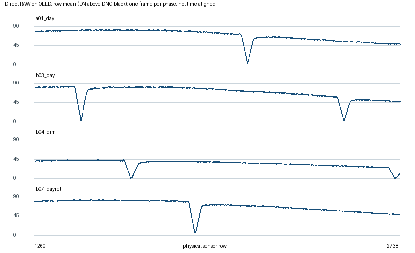
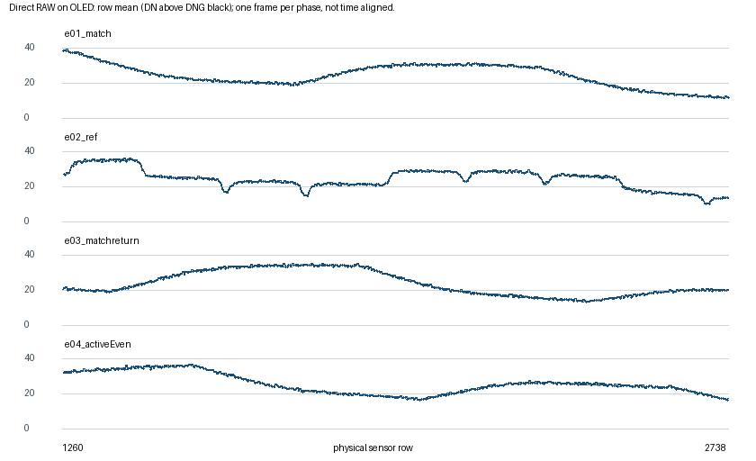

# R33: прямая камера на OLED, Nothing A001 EXPERT 1×

**На дневном белом BL 6692 `0x8e` не убрал глубокую полосу: при 200 мкс её камерная глубина в стоке и рецепте перекрывается (~93–94%).** При обычных 144 вместо 120 Гц в этой серии она уменьшилась до 88,5–89,0%, но не исчезла. Штатный Extra Dim при неизменном BL примерно вдвое уменьшил сигнал, при этом локальная относительная глубина не уменьшилась. Это новые сравнения самого OLED, а не снимки прибора.

**Геометрия и метод.** В отличие от R32, A001 видит сам Lenovo, а не прибор. XT2611-1 GLOBAL `W3WWS36.65-64-4-1`; `confirmed-on-target` — состояние исследуемого телефона; `confirmed-other-device` — измерение камерой A001. Для этого раунда **не использовались осциллограф и его калибровка**. Старые 0,6× flat и ROI также не использовались. Оригиналы DNG и служебные дампы приватны.

Пилот `#FFFFFF`, рецепт, sysfs BL 6692: сохранён настоящий DNG штатного основного 1×, `4080×3072`, фокусное `5,56 мм`, CFA `GBRG`, Orientation `1`, WhiteLevel `1023`; теги кадра: `ISO 6400`, `200 мкс`. По отдельной миниатюре линейного RAW до сравнения профилей зафиксирован **ROI `[630:1370,540:720]` в координатах ячеек 2×2** (физические строки `[1260:2740]`, столбцы `[1080:1440]`); внутри однородного поля, без рамки, навигационной черты и проводов. Координаты неповёрнутые. В пилоте среднее 67,32 DN над чёрным и нулевой клиппинг зелёных; этот кадр не реплика испытательных фаз.

**Метрики.** [Анализатор](analyze.py) декодирует DNG, вычитает собственные BlackLevel обоих зелёных сайтов и усредняет их в ячейке. Публикуются фактическая выдержка/ISO каждого кадра; средний уровень в DN не является калиброванной яркостью в нитах. `camera_amp_pct = 100 × (P95−P05)/(P95+P05)` по блокам 5×5 ячеек; также CV, доля блоков ниже 65% среднего, размах DN и наибольшая пространственная FFT-компонента после вычитания плоскости. Градиент освещения попадает в процентильную метрику. Например, в пилоте он даёт размах плоскости 44,92 DN против размаха P95−P05 43,16 DN: **33,2% широкопольного контраста не означают ШИМ глубиной 33,2%.**

Узкие полосы занимают меньше 5% строк и могут исчезнуть из P05. Поэтому `row_notch_pct` отдельно показывает самое глубокое падение **профиля строк** от местного плато: среднее по ширине ROI, сглаживание на 3 Bayer-строках, деление на скользящую медиану 81 строки, без краёв. Ширина — в исходных строках на половине глубины; координата минимума и смещение между половинами ROI нужны для контроля согласованности. У пилота: 94,3%, 28 RAW-строк, смещение 0 строк. Это относительный **контраст на снимке** при конечной выдержке, не восстановленная временная форма. Ни частота кадров, ни ранее наблюдавшийся skew видео/превью не калибруют время строки EXPERT RAW.

Допуск для количественного сравнения полос: единые ROI/выдержка/ISO, отсутствие клиппинга, покадровый средний сигнал ≥20 DN над тегом чёрного. В подпороговых строках FFT, проценты и глубина не публикуются; тёмная сцена нужна как контроль фона. Новые группы квалифицируются по прочитанному BL и фактическому HWC до/после окна; три или четыре кадра в окне — не независимые применения рецепта.

**Проверка чёрного.** Три прямых кадра `#000000` при 200 мкс дали в ROI `+0,141…+0,164 DN` над средним тегом чёрного зелёных сайтов (63,755 DN). Размах P95−P05 блоков на чёрном 1,54–1,56 DN. Оценка временного σ из попарных разностей блоков, делённых на √2, — 0,44–0,45 DN. Это проверка фона сцены, не измерение закрытого сенсора. При BL 6692 стоковые `#212121` и `#404040` на той же выдержке дали соответственно 0,83–0,95 и 3,55–3,56 DN над тегом (все 6 кадров ниже допуска). Даже у 20 DN половина наблюдаемого размаха чёрного — порядка 4% среднего: сам проход порога не доказывает остаток <3%.

На графике BL 6692: рецепт (`a01`), сток (`b03`), тот же сток с Extra Dim (`b04`), возврат без Extra Dim (`b07`). Общая шкала **DN над чёрным**, без нормировки вертикали между фазами; №2 в каждой, фазы затвора не выравнивались. Наклон светлого плато объясняет, зачем помимо широкопольного контраста измерять провал относительно соседних строк. В первых четырёх `a01` минимум переместился между физическими строками 1616 и 2318, между левой и правой половинами одного кадра расхождение всего 2 строки; это не неподвижная царапина или провод.

Независимая проверка двух зелёных CFA-сайтов **до объединения**: в четырёх `a01` глубины одного и того же минимума `92,8–94,0%` (G1) и `93,3–94,1%` (G2), положение в пределах одной ячейки Bayer. В четырёх стоковых `b03`: `92,5–94,3%` и `92,9–94,5%`, одна и та же ячейка в каждом кадре. Значит, провал в этом окне не создан сложением разных цветов или единичным шумовым пикселем.

### Белый при BL 6692: 200 мкс, ISO 6400

| Фаза (все кадры окна) | Средний G, DN | Локальная глубина в кадре | Ширина на половине глубины, RAW-строк |
|---|---:|---:|---:|
| `a01` рецепт, 120 Гц (4) | 67,80–68,87 | 93,08–93,87% | 28–30 |
| `b03` сток, 120 (4) | 67,64–69,07 | 92,72–94,41% | 28–30 |
| `b04` сток + Extra Dim, 120 (3) | 35,24–35,76 | 96,69–96,90% | 34 |
| `b07` сток, возврат (3) | 69,18–69,43 | 93,40–93,86% | 28 |
| `c02` свежий рецепт, 120 (4) | 68,16–69,49 | 93,60–94,47% | 28–30 |
| `c03` тот же рецепт, 144 (3) | 67,83–68,83 | 88,47–89,01% | 28 |
| `c04` тот же рецепт, возврат 120 (3) | 67,61–69,19 | 93,23–94,25% | 28 |

Смена рецепта отделена проверенным `stop`; A′ подтверждена на новом пробуждении. У Extra Dim матрица SF изменилась с `(1,.965,.914)` до `(.522,.504,.477)` и вернулась. На A/B/A герцовки **фактический HWC** был 0/1/0 до и после соответствующих окон. При 120 признаки двух полных провалов в одном ROI, когда обе границы видны, разделяли 1065–1067 исходных строк в `b03/c02/c04`; это **не** перевод шага в Гц. Вся короткая серия: 48 рабочих DNG в 14 окнах + пилот; все файлы 1×, фактические 200 мкс/ISO 6400, ни одного клиппированного зелёного сайта в ROI. Вечерние 512 (`a03/b01/c01`) дали всего 1,31–1,53 DN; по этим 12 кадрам не заявляем процент глубины. Stock 3601 — 16,85–17,01 DN, также ниже допуска на 200 мкс.

[Покадровые данные](frames.csv) соединяются с [реестром окон](windows.csv) по `phase_ordinal`, порядок строк реестра — хронология окон. `sysfs_bl` — прочитанная уставка, не новый DCS readback. Окно без обоих совпадающих HWC/BL и проверенного состояния не засчитывается. Результат не является тестом комфорта.

### Два способа получить один вечерний уровень

Сток, обычные 120 Гц, Extra Dim OFF. Цель — выбрать серый при **фиксированном высоком BL 6692**, который даёт тот же средний свет, что белый при **BL 512**. Не угадывали уровень по гамме: начали со sRGB-кода 33 и поправили по измерению. Критерий заранее — медианы в пределах ±5% и воспроизводимый возврат. На 25 мс/ISO 6400 фактические теги одинаковы, клиппинга нет. В таблице медианы G в DN **после вычитания медианы той же чёрной сцены** (2,094 DN над BlackLevel при BL 6692); единицы камеры, не ниты. 25 мс используются только для среднего: на номинальных 120 Гц это три периода.

| Сток, сцена | BL | Первый замер | Повтор |
|---|---:|---:|---:|
| Белый (вечерний эталон) | 512 | 151,81 | 152,38 |
| `#212121` (код 33) | 6692 | 97,60 | — |
| **`#282828` (код 40)** | 6692 | **150,83** | **150,71** |

Различие кода 40 с эталоном **−0,64% в первой паре, −1,10% при возврате**. Дрейф эталона +0,38%. Это подтверждение равного среднего **для этих двух однотонных патчей**, не готовый коэффициент для всего интерфейса Android. Для сравнения, на рецепте белый при BL 512 дал 149,41 DN при той же экспозиции. Частота и глубина модуляции по 25-мс среднему не выводятся.

Для сравнения остаточных полос используются **отдельные 4-мс кадры**, без клиппинга и только при ≥20 DN. Для каждой сцены делим её блоки на покоординатную медиану трёх независимых 25-мс кадров того же патча/BL/профиля; это убирает значительную часть неподвижного наклона поля. Тем же способом проверяем каждый длинный кадр по двум остальным, не деля его на себя. [Расчёт](matched_contrast.py): `flat_block_contrast_pct` — нормированный размах P05–P95 блоков, `flat_row_p01_dip_pct` — `100×(1−P01/P90)` профиля строк после коррекции. Средний чёрный сцены вычитался для подбора света; из пространственных блоков вычитаются только их CFA BlackLevel. **На 4 мс** прямоугольная экспозиция передаёт лишь ≈66% амплитуды синусоиды 120 Гц и ≈4% на 720 Гц; отрицательный высокочастотный вывод по такой экспозиции невозможен.

В четырёх кадрах каждой из первых двух 4-мс фаз профили строк в левой и правой половинах скорректированной ROI согласуются: Pearson `r=0,9969–0,9977` на подобранном сером, `0,9957–0,9963` на вечернем белом. Это контроль против объяснения наблюдаемой структуры независимым считывающим шумом соседних столбцов, не частотная калибровка.

| Окно, 4 кадра на фазу | Средний G при 4 мс, DN | Контраст блоков после flat | Провал строк P01 от P90 после flat |
|---|---:|---:|---:|
| Сток, высокий BL + серый 40 (`e01`) | 23,09–24,30 | 31,30–32,09% | 45,50–46,13% |
| Сток, вечерний BL + белый (`e02`) | 23,78–25,01 | 28,41–30,70% | 50,88–54,43% |
| Сток, возврат высокий BL + серый 40 (`e03`) | 23,54–25,65 | 31,35–31,90% | 45,04–46,44% |
| Рецепт, вечерний BL + белый (`e04`) | 22,86–25,64 | 31,67–32,20% | 45,81–46,70% |

Длинные контроли при делении каждого кадра на два других дали всего **1,14–2,40%** по метрике провала строк; [все кадры и обе метрики](matched.csv). **Гибрид «высокий stock BL + серый» уравнял средний свет и немного уменьшил провал строк против вечернего стока, но не приблизился к <3–5%.** По контрасту блоков результат даже чуть выше стока. На проверенных патчах он близок к вечернему `0x8e`, а не к отсутствию модуляции. Это не исключает другой аппаратный режим или другой LUT. При первом переходе с 25 на 4 мс UI закрыл ползунок выдержки; до любого 4-мс кадра сработал останов, BL и сессия вернулись. Затем ползунок открыли явно, повторили только 4-мс серию с подтверждёнными тегами; длинные кадры не дублировали.
