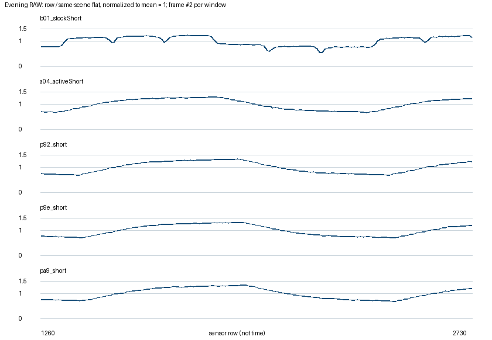
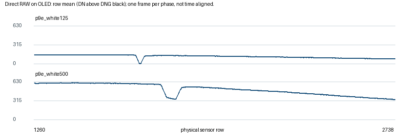

# R34: проверка 9D=92/9e при равном вечернем свете

**Итог: ни `92`, ни `9e`, ни A9-only не прошли вечерний приборный гейт.** На белом коды заметно меняют свет, но после уравнивания среднего под ними остаётся широкий провал, сопоставимый с обычным `0x8e`. Два независимых входа в каждый кандидат. **196 прямых DNG снято: 192 кадра в 64 принятых окнах, один пилот и три отклонённых кадра.** Из 193 файлов в [таблице метрик](frames.csv) ни у одного нет клиппинга зелёных в ROI, у 50 сигнал ниже 20 DN — без процентного вывода о полосах.

| Режим, BL 512, обычные 120 Гц | Патч для сравнения | Провал строк, 4 мс | Амплитуда Микельсона блоков P05/P95, 4 мс |
|---|---|---:|---:|
| Сток | белый | 50,79–53,28% | 27,95–28,43% |
| Действующая сессия `0x8e` | белый | 46,05–46,75% | 31,19–31,61% |
| `9D=92` | `#4b4b4b` | 45,38–47,00% | 31,10–32,23% |
| `9D=9e` | `#181818`, совпадение после вычитания своего чёрного | 44,41–45,28% | 30,23–31,17% |
| `9D=9e` | `#171717`, совпадение по **полному** сигналу | 46,51–47,19% | 31,66–32,17% |
| A9-only | `#8d8d8d` | 45,46–46,47% | 30,91–32,08% |

Диапазоны включают все принятые совпадающие окна на указанных настройках, не лучшие отдельные кадры. Независимое повторение — вход из стока в новой эпохе wake, а не ещё один кадр того же окна. Проценты — пространственные метрики камеры на указанной выдержке, не мгновенная глубина излучения панели.



Кадр №2 каждой указанной фазы, деление на независимый flat того же патча, нормировка среднего к 1; фазы не выравнивались. [Значения профилей без исходных фотографий](rows.csv).

**Вопрос:** меньше ли камерная модуляция у уже испытанных режимов `92/9e`, когда средний сигнал равен стоковому белому при BL 512, а не когда каждый режим показывает разную яркость? Источник — [правила исследования](../../AGENTS.md), [лестница 9D](../ddic_round22_31_9dladder_20261120/result.md), [прямой контроль R33](../direct_camera_r33_20261120/result.md). Стенд: только прямая A001 → Lenovo, без осциллографа и без тестов глазами.

**Протокол до сравнения.** Один оператор; та же сборка/панель, стоковый Flicker prevention OFF, обычные 120 Гц (`hwcId=0`), BL 512, однородные SDR-патчи. Не оставлять испытуемый профиль установленным, не менять действующий applier. Вход только из проверенного стока после `stop`, проверять читаемые поля, возврат, ESD и уставку. При невозможности подтвердить состояние — не принимать снимок за опыт этого профиля. A9-only проверяется отдельно от 92/9e, если доступен точный ранее испытанный вход.

На A001 — нативный EXPERT RAW основного объектива 1×, ISO 6400, линейные зелёные сайты. До сравнения проверить геометрию фиксированной ROI R33. На 25 мс вычесть фон сцены и подобрать серый до ±5% от медианы стокового белого; проверить повтором. Длинные кадры служат только для среднего и пространственной коррекции. Сравнить полосы отдельно на 4 мс с ≥20 DN над чёрным, без клиппинга, в том числе провал P01/P90 строк и контраст P05/P95 блоков после деления на длинный референс той же сцены. Белый на короткой выдержке — отдельная проверка гипотезы «тихий яркий режим», не равнояркое сравнение. Не выводить физические Гц из шага строк или отсутствия полос.

**Геометрия (`confirmed-other-device`).** На отдельном белом пилоте при BL 6692: 4080×3072, Orientation 1, 5,56 мм, ISO 6400, 200 мкс. В неповёрнутых ячейках Bayer 2×2 верхний край панели `y=558` при `x=640`, боковые края `x=446/1117` при `y=800`, пересечение с проводом `x=919/849` при `y=1250/1369`. Поэтому прежняя ROI `[630:1370,540:720]` целиком на однородном патче и вне проводов. Среднее пилота 67,24 DN над тегом чёрного, клиппинга зелёных нет. Рецепт и сток имеют свои новые контроли при BL 512; фон чёрной сцены прошлой серии при BL 6692 не подставляется.

**Что именно повторяется.** Для `92/9e` известный порядок из стока: `23:A9=8e → 24:9D=92` (или `9e`) `→ 23:80=90`. Это не R30 с `A9=0e` и не замена одного `9D` поверх активного рецепта. Для [некомпенсированного A9-only](../ddic_4f81_23a9_06x_dng_20261119/result.md) — только `23:A9=8e`, остальные два байта остаются штатными. Разрешение — продолжение владельцем именно известных оптических проб с возвратом; не разрешение на новые команды, полный перебор банков или постоянное применение. Старт из восстановленного штатного ядра и свежего wake не тождествен отправке всего старого многорегистрового снимка R22. Поэтому критичны и readback, и фактическая оптика.

**Свежие опорные окна (`confirmed-on-target` для состояния, `confirmed-other-device` для RAW).** Сток/512/белый, 25 мс: медиана 154,994 DN, собственный чёрный 0,180 DN, цель **154,814 DN над фоном сцены**. У `0x8e` на том же белом 151,275−0,167=151,108 DN (−2,4%). На 4 мс в каждом из четырёх кадров стока скорректированный flat провал строк P01 от P90 **50,79–53,28%**, контраст блоков **27,95–28,43%**; у `0x8e` **46,05–46,75%** и **31,19–31,61%**. Это локальные эталоны R34, а не числа, перенесённые из R33. Самопроверка трёх длинных кадров по двум другим: провал строк в стоке 1,66–2,23%, у `0x8e` 1,23–1,32%.

**Привязка DNG к состоянию.** [Временная проба](build_probe.py) использует совпавшие с установленным applier функции и те же блокировки, отдельный каталог, только заранее определённые программы и новое чтение `00:52`. Она не имеет boot hook и не меняет установленный скрипт. Проверен фактический отказ `session worker busy` до `stop`. У первого входа `92` прочитано `A9/9D/80=0e/0e/50 → 8e/92/90`, `C1=0002be → 000010`, панельный DBV `0200` в обоих случаях. Перед и после каждого окна кандидата требуются те же пять полей, page 0 и подтверждённый ESD `reg_read`, а также неизменные поколение wake и HWC. Сторож на устройстве ограничивает время эксперимента при потере хоста штатным `SLEEP`; не является повторным apply. Оптика стоковых контрольных окон и оптика кандидатов — отдельные наблюдения от readback.

**Как читать метрики.** `flat_block_contrast_pct = 100×(P95−P05)/(P95+P05)` по блокам из 50 зелёных сайтов; `flat_row_p01_dip_pct = 100×(1−P01/P90)` по профилю строк после деления блоков на медиану длинных кадров той же сцены и профиля. Это разные проценты. `row_notch_pct` у белых коротких кадров — падение строки от соседнего локального плато, без длинного flat. Уровень в DN — сигнал камеры, не ниты. `column_sets_r` сравнивает профили независимых чередующихся столбцов, их полуразность — контроль части шума, не доверительный интервал. Для синусоиды передача экспозиции 4 мс составляет 0,662 на 120 Гц, 0,041 на 720 Гц, ноль на 250 и 2000 Гц в идеальной модели. Положительный провал на такой выдержке измерим; отрицательный результат по одной выдержке не доказывает DC.

**Белый `92`, не равнояркая серия.** При 500 мкс три прямых DNG дали 42,45–43,42 DN и локальный провал **64,78–65,50%**, ширина 46–48 исходных строк. При 125 мкс сигнал 10,35–10,69 DN, поэтому глубина по этим кадрам не квалифицирована. На той же 1× методике в R33 белый stock/3601 при 500 мкс дал 43,85–43,96 DN и 64,4–65,5%: сходство поддерживает эффект уровня аппаратного драйва, но не доказывает тождество внутренних режимов. Режим `92` на белом не свободен от глубоких провалов.

**`92` при равном среднем свете.** Код 86 оказался слишком ярким. На `#4b4b4b` (75) медианы 25 мс относительно собственного чёрного составили 152,69 и 152,89 DN после возврата с белого; к эталону **−1,37% и −1,24%**. На 4 мс провал строк **45,38–46,27%**, после возврата **45,71–47,00%**, контраст блоков суммарно **31,10–31,93%**. В первой фазе на независимой полосе `x=725:800` тех же строк провал 45,67–46,58% при 26,44–27,73 DN: эффект не держится на одной ROI. Преимущества над прежним `0x8e` по двум метрикам нет. Штатные `0e/0e/50`, `C1=0002be`, DBV 512 и ESD перечитаны после эксперимента; белый при стоковом возврате 155,25–155,52 DN над тегом.

**`9e`.** Яркий белый, 125 мкс: 120,45–122,18 DN, без клиппинга. Локальный провал **98,13–98,36%**, ширина на половине глубины 24 исходные строки в 3/3 кадрах. Минимум движется (строки 1540–1692), разница между половинами ROI 0–2 строки. Это соответствует примерно 96–97% камерного контраста Микельсона для минимума и соседнего плато. На 500 мкс: 501,71–502,16 DN, глубина лишь **35,37–36,03%**, ширина 58 строк. По одной длинной выдержке нельзя судить о максимуме модуляции. Гипотеза «белый `9e` не имеет глубоких провалов» опровергнута для этого входа и BL.

На подобранном сером **`#181818` (24)** первый/возвратный длинный замер дал **+2,61% / +2,66%** к стоку после вычитания собственного чёрного. На 4 мс провал строк **44,78–45,08% / 44,41–44,79%**, контраст блоков **30,55–30,83% / 30,23–30,53%**. Это немного ниже `0x8e`, но далеко от плоского профиля. Важная оговорка: в `9e` при 25 мс даже чёрная сцена дала 5,53 DN против 0,18 в стоке. Медианы вне экрана на тех же строках (`x=245:400`) также сдвинулись: 2,88 против 0,42 DN. Нельзя весь сдвиг объяснить ни исключительно чёрным OLED, ни исключительно смещением АЦП. **Полный сигнал** кода 24 до вычитания фона был выше стока на 6,06–6,11%; разница между критериями требует проверки соседнего кода 23. Стоковый readback и ESD вернулись.

**Первый A9-only.** При `8e/0e/50`, DBV 512 и `C1=000010` понадобился более светлый `#8d8d8d` (141): медиана 25 мс на **−3,40%** к стоку после вычитания фона. На 4 мс провал строк **45,81–46,09%**, контраст блоков **31,24–31,95%**. На чистом белом 500 мкс дают только 19,36–19,42 DN, поэтому процент не принимается; на 1250 мкс — 48,26–48,82 DN и 16,77–17,37% локального провала, при другой передаточной функции экспозиции.

После пяти ступеней подбора у A9-only не закрылось последнее окно `pa9_flatret`: пропало стабильное awake-состояние в пределах ограничения времени. Три DNG без post-проверок [отделены](rejected.csv); ни средний свет, ни flat из них не используются. У `pa9_shret` обе проверки были успешны, для него используется начальный flat того же кода. Откатная команда была отклонена **до I/O**; после обычного полного wake независимый `stock-check` прочёл `0e/0e/50`, `0002be`, `0200`, ESD `reg_read`. Это восстановление через wake, **не** успешная запись `restorea9` в прежней эпохе. Для повторной проверки — свежий вход без подбора и прямой контролируемый возврат.

### Независимые входы и проверка двух тёмных точек R28

- **A9-only:** новый вход на `#8d8d8d` дал −3,19% к эталону по среднему над собственным чёрным. Провал 46,04–46,45%, амплитуда блоков 31,57–32,08%. Запрошенных 6,25 мс интерфейс 1× не выставил (переключался между 5,00 и 6,667 мс); такого окна не заявляем. При завершении этой попытки состоялся именно прямой `restorea9`: `8e/0e/50 → 0e/0e/50`, `C1 000010 → 0002be`, `00:52=0200`, ESD восстановлен.
- **92 и 9e:** свежий вход на тех же кодах дал −0,90% и +3,60% к эталону после вычитания собственного фона. На **фактических 6,667 мс** провал при подобранном свете уменьшился до 19,24–22,57% (`92`) и 21,20–21,77% (`9e`), то есть профиль не стал плоским и на другой выдержке. При 4 мс профили чередующихся наборов столбцов у обоих кодов и A9-only согласуются (`r≥0,996`), а блоки того же участка на независимых длинных контролях дают гораздо меньший разброс. На параллельной ROI `x=725:800` в первых четырёх кадрах при 4 мс у `9e` провал **47,46–48,19%** против **45,49–45,81%** у `8e`. Разница порядка 1–2 п.п. в пользу `9e` на основной ROI не является устойчивым выигрышем.
- **Проверка фона `9e`:** во второй сессии код 23 дал полный сигнал 151,13 DN против 154,99 в стоке (**−2,49%**); после вычитания чёрного — на 5,92% ниже эталона. На этом коде провал **46,51–47,19%**. Наоборот, код 24 во второй сессии был в допуске по приращению над чёрным, но по полному сигналу +7,02%. Выбор определения среднего не спасает профиль. Стоковые белые возвраты после `92/9e` остались в пределах 0,4% от исходного среднего.
- **Точный `92/#404040` из R28:** при 4 мс 16,32–18,47 DN, отказ по сигналу; при 6,667 мс 28,18–28,26 DN и провал **22,07–22,73%** (3/3). **Точный `9e/#101010`:** при 4 и 6,667 мс ниже 20 DN (13,85–14,18 и 19,33–19,75); при 10 мс 29,23–29,47 DN и провал **22,35–22,47%** (3/3). Теперь есть положительная прямая регистрация полос на этих двух серых точках выше порога шума. Она не реабилитирует старые подпороговые значения и не исключает более быструю модуляцию, скрытую длинной выдержкой.



### Верификация и возврат

[64 окна и пилот](windows.csv), [5 регистров, состояния и возвраты](registers.csv), [какие длинные кадры образуют flat](flat_map.json). Для каждого окна кандидата проверяются два readback и обе границы HWC; отклонённое окно в сумму не включено. Воспроизведение на хосте с приватным архивом:

```sh
d=artifacts/direct_camera_r34_20261120
e=../../private-bench-evidence/direct-r34-20261120
python3 -B "$d/build_probe.py" --check
python3 -B "$d/measure.py" "$e/frames" --roi 630 1370 540 720 --flat-map "$d/flat_map.json" | diff -u "$d/frames.csv" -
python3 -B "$d/receipts.py" "$e"/probe-{92,9e,a9,repeata9,repeat92,repeat9e}.log | diff -u "$d/registers.csv" -
python3 -B "$d/windows.py" "$e" "$d/frames.csv" --receipts "$d/registers.csv" --rejected "$d/rejected.csv" | diff -u "$d/windows.csv" -
```

Финальный возврат `confirmed-on-target`: временный каталог пробы удалён, установленный applier побайтно совпадает с исходным, `running / active: verified`, ручная яркость 102, BL 6692, `panelDC=0`, min/peak `120.0/0`, Extra Dim отсутствует, исходная `Settings.SubSettings`. У A001 — штатный PHOTO 2×, геометрия не менялась. Новых банков DDIC, flash, постоянного профиля и теста глазами не было. Следующее различающее направление — искать изменение **периода/структуры EM**, а не подбирать ещё один код `9D` ради того же среднего света. Перед новой страницей квалифицировать известную `23` и возврат на узком пути переписи; `FE==page` само по себе не доказывает новый банк.
