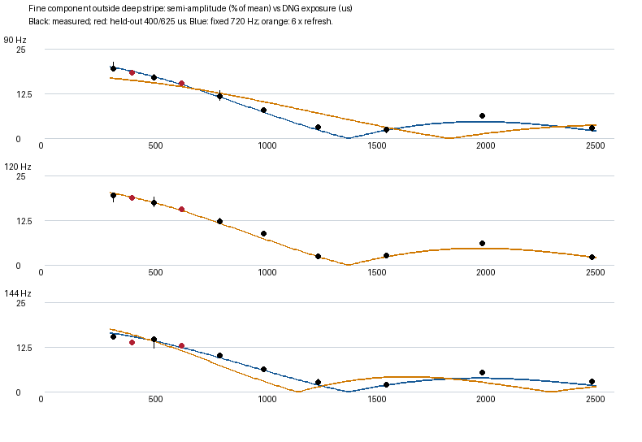

# R35: меняется ли частота мелкой волны вместе с развёрткой?

**Нет признаков пропорционального ускорения мелкой волны на 90 → 120 → 144 Гц.** На стоке, BL 3600, прямая съёмка поддерживает **общую компоненту около 720 Гц** существенно лучше, чем 540 → 720 → 864 Гц. Геометрический признак на тех же кадрах: около **8 → 6 → 5** мелких периодов между глубокими полосами. На 3601 мелкая волна почти исчезает **вне широкой полосы**, но сама широкая полоса остаётся глубокой. Режима ≥2 кГц без глубоких провалов или true DC этот раунд не нашёл.

| Обычный HWC | Шаг мелкой волны при BL 3600, RAW-строк | Мелких периодов между широкими (длинная полоса ROI) | Полуамплитуда вне провала, 500 мкс: BL 3600 с возвратом → 3601 |
|---|---:|---:|---:|
| 90 Гц (`4`) | 177,40 | 7,987–8,018 | 17,29–17,78% → 0,09–0,45% |
| 120 Гц (`0`) | 177,35 | 5,997–6,003 | 17,48–18,02% → 0,10–0,15% |
| 144 Гц (`1`) | 188,50 | 4,988–5,004 | 14,04–14,50% → 0,27–0,31% |

Шаг и полуамплитуда — [основная ROI](spacing.csv); [длинная ROI](long_strip.csv) нужна для межсобытийного расстояния, особенно при 90 Гц, где в основной ROI не хватило двух полных событий. При 144 Гц шаг в **пикселях** даже увеличился; такой результат от одного калиброванного коэффициента «пиксель = микросекунда» для всех режимов получить нельзя при неизменной временной частоте. Пространственная фаза зависит и от сканирования самого экрана.

**Протокол.** Nothing A001, основной объектив 1× EXPERT RAW, ISO 6400, непосредственно перед OLED Lenovo XT2611-1. Осциллограф, его разметка и калибровка не используются. В новом пилоте на белом, `0x8e`/BL 6692, измерено 67,32 DN над тегом чёрного при 200 мкс; фактические `4080×3072`, `5,56 мм`, ориентация 1. На `y=800/1250/1369` границы белого поля по половине локального плато в `x=445:1118 / 446:921 / 447:851` ячеек Bayer. ROI оставляем [той же](../direct_camera_r33_20261120/result.md): `[630:1370,540:720]` ячеек 2×2, 1480 исходных строк. Пилот не включается в модель.

**Различающие измерения.** На стоке, белый RGB 255, `panelDC=0`, при BL 3600 (сильная мелкая волна в R33) сравнить 90/120/144 Гц. Условие окна — `stopped: stock registers verified`, фактические HWC 4/0/1 и BL с обеих сторон, выдержка из DNG, ≥20 DN и отсутствие клиппинга зелёных для количественных амплитуд. Через камеру проверяются отдельно: (а) изменяется ли пространственный шаг между режимами; (б) на каких известных длительностях экспозиции подавляется одна и та же пространственная компонента; (в) не вносит ли отдельная глубокая полоса ложную «мелкую волну» даже после перехода на 3601. Помимо разных выдержек, положительный контроль `3600 → 3601 → 3600` на 500 мкс в каждом режиме. Нельзя принимать наименьшую глубину после усреднения за физическую глубину OLED.

При постоянной временной синусоиде и прямоугольном интегрировании по времени `A(T)=A₀ |sin(π f T)/(π f T)|`. Кандидаты — постоянные 540/720/864 Гц, шесть периодов на кадр (`6×` фактической частоты развёртки), свободный поиск и высокочастотная альтернатива. Частотная ось модели задаётся длительностями экспозиций, **не шагом полос × придуманное время строки**. Отдельно проверить: шаг по кадрам вне провала, восстановление под порогом BL, влияние широкого события и прогностическую ошибку, когда одна выдержка исключена из подгонки. Модель описывает одну видимую компоненту, не исключает гармоник или низкочастотной огибающей. Ни значение `23:C1`, ни наилучшая точка сетки сами по себе не проходят приборный гейт.

**Независимый пространственный контроль.** [spacing.py](spacing.py) не использует функцию передачи выдержки. Изолирует широкие тёмные события на 500 мкс, исключает их с запасом 40 Bayer-строк, на оставшихся светлых участках убирает отдельный квадратичный фон и совместно подбирает три гармоники. На начальной тройке при 120 Гц шаг мелкой волны **177,35–177,40 RAW-строки**. В каждом кадре между двумя полностью видимыми тёмными событиями **6,001–6,009** таких шагов. При зафиксированном шаге медианного кадра полуамплитуда первой гармоники **17,91–18,02%** на BL 3600, **0,10–0,15%** на 3601, **17,48–17,97%** после возврата; это доля от локально нормированного плато, не контраст Микельсона по площади. Сам широкий провал не исчезает: по метрике `row_notch_pct` R33 на BL 3601 при этих же 500 мкс **64,14–65,01%**, ширина 48–50 исходных строк. Тем самым исчезновение мелкой волны не является переходом к true DC.

**Проверяемые предсказания по регистрам, до новой матрицы.** В [архиве квалифицированных чтений](../c1_live_20261108/stock_sweep.json) `C1` на DBV 3600 при 90/120/144 Гц равен 128/96/80. В этой точке `refresh × C1 = 11520`, а `C1/16 × refresh = 720`; на DBV 1024 при 120 Гц ранее читался 684 (`0002ac`). Масштабирование *всего* кода как `1/r` предсказывает на 1024 **912 / 684 / 570**; независимая от яркости *добавка* режима — **716 / 684 / 668**; отсутствие влияния режима в этом диапазоне — **684 / 684 / 684**. Иное число отвергает все три простые модели в данной точке. Для 3601/4096 различаем общий зажим на 16 и продолжение обратного масштабирования (около 21/16/13). `C2=900` — ожидаемый трёхбайтовый ответ драйвера, не заранее известная единица времени.

**Прогноз на независимый вход, до его съёмки.** При 120 Гц на восьми выдержках 312,5–2500 мкс медианы полуамплитуды с маской составили 19,37 / 17,28 / 12,08 / 8,73 / 2,47 / 2,54 / 6,00 / 2,07%. У лучшей синусоидальной модели по этим данным `f=710 Гц`, RMSE 0,68 п.п., у лучшей выше 2 кГц — 7154 Гц, 2,14 п.п. Обе предсказывают **15,3% при 625 мкс**: одной этой новой выдержкой модели не различить. Поэтому вводим второй ранее не показанный модели интервал **400 мкс**, на нём предсказания **18,93% против 10,12%** соответственно. Внешние окна из новой сессии с readback исключены и из выбора пространственного периода, и из временной подгонки; сравнивать только после прохода оптических и аппаратных проверок.

**Второй срез геометрии.** Чтобы в ROI могли поместиться два глубоких события и при 90 Гц, повторить пространственный анализ на более длинной и узкой полосе `[605:1475,540:640]`. В свежем белом пилоте верхняя граница поля на этой полосе около `y=559`, внизу поле продолжается за `y=1500`. В R35 на BL 3600 промежутки между полными тёмными событиями в этой полосе на 90 Гц содержат **7,99–8,02** мелкого периода, на 120 Гц — **6,00**, тогда как мелкий шаг почти одинаков: **177,55 / 177,60 RAW-строк**. Уже эти две реальные развёртки несовместимы с «всегда шесть мелких полос на одну глубокую». Это геометрическое отношение в одном кадре, не расчёт Гц.

### Частота из подавления компоненты выдержкой, а не из числа строк

При BL 3600 — 28 кадров на каждый из трёх режимов (312,5 / 500 / 800 / 1000 / 1250 / 1562,5 / 2000 / 2500 мкс). На каждой выдержке в одном режиме одна медиана, независимо от числа кадров. Свободный параметр масштаба для каждого HWC; в общей модели постоянной частоты одна частота для всех трёх. Таблица — ошибка в **процентных пунктах полуамплитуды / среднее ROI**, после исключения части строк широкого провала по алгоритму [carrier.py](carrier.py). Это не цель R3 по допустимой модуляции.

| Модель | RMSE по 24 медианам | RMSE прогноза при исключении целой выдержки сразу у всех трёх режимов |
|---|---:|---:|
| Постоянные 720 Гц | **0,75 п.п.** | **0,89 п.п.** |
| `6×refresh` (540/720/864) | 2,04 п.п. | 2,35 п.п. |
| Лучшая постоянная, поиск 100…10000 (705 Гц на полном наборе) | 0,70 п.п. | 0,83 п.п. |
| Лучшая постоянная выше 2000, поиск до 10000 (7144 Гц) | 2,00 п.п. | 6,78 п.п. |

Без маски широкого провала общий минимум **720 Гц**, RMSE 0,81 п.п.; `6×refresh` 2,49 п.п. По отдельным режимам с маской минимумы 705 / 710 / 699 Гц. Нельзя заявить точность до 1 Гц: меняются маска, профиль плато, рабочая фаза затвора; отдельная частота может слабо сдвигаться. Независимый расчёт на 120 с раздельными квадратичными фонами по сторонам события, фиксированным шагом 177,35 RAW-строки и отступом 20 Bayer-строк за найденными фронтами дал минимум 720 Гц; изменение отступа на всех выдержках до 5–40 строк даёт 716–726 Гц. У обеих основных обработок отношение ошибок говорит за одну и ту же **область**, а не за точное значение. Камера измеряет зависимость известной компоненты от выдержки; результат не исключает сосуществования другой несущей или гармоник.



**Проверка опубликованного прогноза в новом физическом входе.** На 120 Гц фактические DNG 400 мкс дали **18,20–19,08%, медиана 18,64%**: ошибка 0,29 п.п. у прогноза 710 Гц против 8,52 п.п. у 7154 Гц. На 625 мкс **14,95–16,09%, медиана 15,52%**: в согласии с заранее сформулированным ограничением, здесь обе модели проходят. Совпадение одной амплитуды на 625 мкс не является доказательством ни той, ни другой частоты. Диапазоны, остатки и предсказания: [покадрово](carrier.csv), [подгонки и исключения выдержек](fit.csv), [независимые выдержки](prediction.csv).

### Глубокая полоса после пропадания мелкой волны (BL 3601)

Это другая метрика: `100 × (1 − min / локальное плато)` на профиле строк, не полуамплитуда синусоиды. Белый, ISO 6400, по три кадра в первичном окне каждой ячейки. DN — над BlackLevel зелёных, не ниты.

| Развёртка | 312,5 мкс: средний сигнал / провал / FWHM в RAW-строках | 500 мкс: провал / FWHM в RAW-строках |
|---|---|---|
| 90 | 26,68–27,09 DN / **91,90–93,25%** / 42–44 | **64,85–66,71%** / 46–48 |
| 120 | 26,25–27,20 DN / **92,46–93,52%** / 42 | **64,14–65,01%** / 48–50 |
| 144 | 26,14–26,56 DN / **90,20–90,88%** / 40–42 | **58,40–59,13%** / 48 |

По каждой фазе в [frames.csv](frames.csv) также есть камерный P05/P95 контраст блоков, CV, средний G и локальная ширина. Суждение «DC на 3601» несовместимо с этими кадрами, несмотря на остаток менее 0,5% **одной гармоники вне полосы**. Уменьшение глубины на 500 мкс — эффект интегрирования: при меньшей выдержке провалы превышают 90% на всех трёх обычных HWC.

**Второй способ получить временной масштаб.** Для изолированной полосы на BL 3601 сравнили два профиля при разных выдержках: короткий дополнительно размывается прямоугольником длинной экспозиции, длинный — короткой. При постоянном градиенте временной фазы по строкам результат обеих свёрток должен совпасть, независимо от формы исходной полосы. [Результаты](blur.csv), [алгоритм и отсев обрезанных событий](blur.py). По парам 312,5/1250 и 500/1250 мкс эффективный градиент — **7,8 / 7,8 / 7,4 мкс на исходную строку** в режимах 90/120/144 соответственно, `R²` медианной формы ≥99,78%. Кадры с одной выдержкой используются в нескольких парах, это не независимые оценки ошибки; на 90 и 120 в 1250-мкс серии пригодно лишь по одному целому событию. Если перенести градиент через **одну единицу DBV** на мелкую волну при 3600, получается `10⁶/(s × шаг)` ≈ **723 / 723 / 717 Гц**. Согласуется с независимым методом экспозиционного подавления. Это модель локального относительного сканирования, **не** измерение аппаратного времени строки сенсора и не доказательство отсутствия других частот.

### Известный банк `23`: матрица с оптикой в том же окне

`confirmed-on-target`: 22 оптических окна обрамлены 44 чтениями. [Парные ответы](readbacks.csv) совпали включая эпоху wake, `23:FE=23`, не-FE сигнатуру `80/82/BA=50/00/00` (два раза в каждом вызове), `A9=0e`, `A4/AD/B4=10/10/10`, `C2=000384` и `00:52` с требуемым DBV. `page=0` — подтверждённый нативным TX возвратный селектор, **не** вымышленный `00:FE` readback. В другой private mount namespace после каждого вызова независимо прочитан ESD `reg_read`. [Реестр окон](windows.csv) разделяет эти окна и начальную серию без одновременного readback. Новые банки и запись данных регистров читателем не использовались.

| DBV / три прочитанных байта `23:C1`, десятичное число | 90 Гц | 120 Гц | 144 Гц |
|---|---:|---:|---:|
| 1024 | **913** (`000391`) | **684** (`0002ac`), возврат 684 | **684** (`0002ac`) |
| 3600 | **128** (`000080`) | **96** (`000060`) | **80** (`000050`) |
| 3601 | **16** | **16** | **16** |
| 4096 | **16** | **16** | **16** |

На 1024 у 90 Гц результат на единицу отличается от пропорционального прогноза 912; на 144 результат **684 вместо 570**, совпадает с 120. Ни одна из трёх простых моделей не описывает всю строку. Выше порога общий код 16 стоит **при разных видимых глубоких провалах**. Ни `C1/16` как универсальное число импульсов, ни `C1=16` как достаточный признак ровного света не подтверждаются. У 90/144 на независимых 400 мкс медианы 18,33% / 13,67%; ошибки низкого и высокого решений 0,32 против 7,98 п.п. / 1,70 против 4,87 п.п. соответственно.

**Объём и возврат.** 147 прямых DNG: 146 кадров в 58 принятых окнах и пилот. Ноль кадров ниже 20 DN, ноль кадров с клиппингом зелёных в ROI. Проверка стыкует внутри одного лога `before → кадры с размерами → WINDOW → after`, фактические HWC/группу/матрицу на обеих границах, экспозицию/ISO из оригиналов. Леново вернулся к исходному applier (проверен SHA), `running / active: verified`, `Settings.SubSettings`, manual 102, BL 6692, `panelDC=0`, min/peak `120.0/0`, ключ Extra Dim отсутствует. Временного читателя не осталось. A001 снова PHOTO 2×, без перемещения. Теста глазами, flash и постоянных изменений не было.

Воспроизведение из корня worktree, имея приватный архив:

```sh
d=artifacts/direct_camera_r35_20261120; e=../../private-bench-evidence/direct-r35-20261120
python3 -B "$d/build_reader.py" --check
python3 -B artifacts/direct_camera_r34_20261120/measure.py "$e/frames" --roi 630 1370 540 720 | diff -u "$d/frames.csv" -
python3 -B "$d/evidence.py" "$e" "$d/frames.csv" series-120.log series-90.log series-144.log cross.log --windows "$e/check-w.csv" --readbacks "$e/check-r.csv"
python3 -B "$d/carrier.py" "$e/frames" --frames-csv "$e/check-c.csv" --fit-csv "$e/check-f.csv"
diff -u "$d/windows.csv" "$e/check-w.csv" && diff -u "$d/readbacks.csv" "$e/check-r.csv" && diff -u "$d/carrier.csv" "$e/check-c.csv" && diff -u "$d/fit.csv" "$e/check-f.csv"
```
