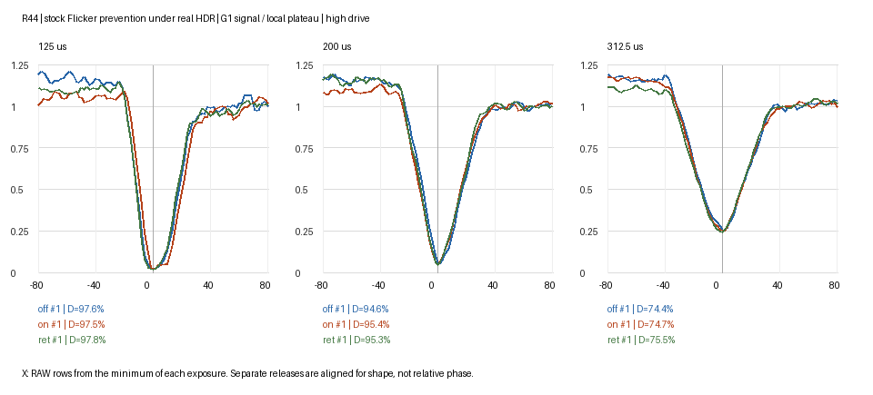

# R44: штатный Flicker prevention OFF → ON → OFF на одном видеослое HDR10

**Итог: на BL 13119 штатный ON не смягчил широкий провал до полезного уровня ни днём, ни вечером.** На прямых RAW в HDR при ON остаются 94,66–95,74% локальной глубины на 200 мкс; на равном вечернем свете — 44,37–45,30% падения строк на 4 мс. Отправка полной таблицы ON доказана отдельно от оптики. При BL 3593 реальный HDR и штатная отправка доступны, но короткие RAW слишком темны для вывода о форме свечения. Профиля для пробы глазами нет.

В [R43](../direct_camera_r43_20261121/result.md) реальный HDR не устранил провал, но работал с сессией владельца `0x8e`. Здесь сравнивается **штатный переключатель**, пока на экране воспроизводится один и тот же полноэкранный PQ-клип. Перед опытом установленный applier остановлен: `stopped: stock registers verified`, дальше в каждом окне требуется `inactive`. Роль Lenovo XT2611-1, сборка `W3WWS36.65-64-4-1`; Nothing A001 снимает экран напрямую, без осциллографа.

**Что меняется и что проверяется отдельно:**

- Штатный запрос идёт через Motorola `display_dc_mode_enabled`. На обеих границах окна читаются **и** настройка provider, **и** `panelDC` драйвера. Исторически оба могли быть `1` до применения части таблицы ([R37](../direct_camera_r37_20261120/result.md)); это не чтение памяти DDIC.
- На время переключения включается штатный журнал *исходящих* MIPI-команд. Содержимое между двумя метками сравнивается с точными 75-пакетными OFF и ON выбранной BOE v4; изолированная трасса измеряет возвраты `dsi_ctrl_cmd_transfer` и `dsi_panel_send_param_cmd`. Это проверка отправки, не оптический результат и не доказательство содержимого всех регистров после отправки. Собственные сырые команды выбора/записи/чтения панели ради этого теста не посылаются. Перед первой сменой — окно без команды настройки для контроля наблюдателя.
- Для всех принятых окон необходимы видимый BT.2020/PQ-слой 720×1584 на полном экране, **текущие** выходы HDR в HWC и SDM, стабильные фактические HWC/BL/эпоха, нормальная температура. В первичном дневном тесте PQ Y′=573, 120 fps, manual 102; в вечернем — PQ Y′=282, 30 fps, и собственный чёрный Y′=64 при той же политике. В каждой освещённой тройке между OFF/ON/возвратом клип не переоткрывается. Отдельный опыт с меньшим приводом имеет смысл только если штатная регулировка действительно достигает BL ≤3600 **при сохранившемся HDR**; тёмный PQ-код сам по себе не понижает привод.

**Предварительное правило сравнения.** G1 в фиксированной ROI R42/R43 `[630:1250,754:799]` нативных ячеек Bayer, основной объектив 1×/5,56 мм, ISO 6400. Отдельные пары CAL проверяют освещённое поле с запасом в 20 ячеек. Днём: глубина `100 × (1−минимум/локальное плато)`, амплитуда Микельсона для тех же уровней и ширина на половине глубины в RAW-строках. При 312,5 мкс полезное изменение должно дать ≥3 годных кадров на состояние, снижение медианы ON минимум на 3 п.п. относительно **каждого** OFF, неперекрывающиеся диапазоны, дрейф медиан OFF ≤3 п.п.; контроль — 200 мкс. Это ориентир по разбросу R43, а не доверительный интервал. Отсутствие годного минимума не означает DC.

Вечером сравниваются и полное среднее, и среднее над собственным чёрным на 25 мс с допуском ±5%; на независимых коротких RAW — падение строк `1−P01/P90` и контраст блоков `(P95−P05)/(P95+P05)` относительно flat **своей фазы**. Двукратное снижение обеих метрик было бы основанием для дальнейшего отбора; целевая граница 3–5% строже. Частота развёртки дисплея не равна измерению частоты PWM.

**Подтверждение первого переключения на железе.** В контрольном интервале при работающем плеере — 0 исходящих пакетов и 0 возвратов наблюдаемых функций. После `PUT 1` в том же HDR при BL 13119 / HWC 0 зафиксирована **одна точная копия таблицы ON: все 75 пакетов**, включая тип, режим, длину и данные. `dsi_panel_send_param_cmd` вернулся один раз с `rc=0`, у контроллера 75 возвратов `0` и один `1`; пропусков у наблюдателей нет. Дополнительный возврат не приписываем конкретной команде. Это положительное свидетельство штатной отправки под HDR, в отличие от вывода только по двум флагам. [Первый проход](initial_dispatch.csv) · [основной проход и счётчики по каждому переходу](dispatch.csv).

**Почему пришлось повторить дневную тройку.** В первом проходе обе таблицы точно совпали с DT, плеер оставался на переднем плане и тот же PQ-слой оставался видим. Однако к концу 600-секундного клипа появились полупрозрачный интерфейс плеера и системные панели: между границами `day_ret_125` вместо **одного** аппаратного слоя стало **четыре**, а на следующих двух выдержках возврата среднее G1 упало примерно на 10%. Ни два флага HDR, ни совпавший ID самого видеослоя это не отфильтровали. Все 42 RAW первой тройки сохранены отдельно и **не используются для сравнения OFF/ON/возврата**. Независимые метки отправки команд остаются пригодны. По завершении этой тройки хостовый shell остановился между сериями; сессия и яркость вернулись, появившееся штатное окно обновления закрыто кнопкой Back без запуска обновления, возврат в исходные Settings проверен отдельно. Для чистого повтора побайтно проверены пакеты 2400-секундных версий тех же полей (четыре копии исходного потока, без перекодирования); допуск теперь требует единственного выводимого слоя на обеих границах.

### День: эффект ON на широком провале не разрешён (`confirmed-on-target`)

В повторе 42 RAW / 12 окон. На всех 24 границах — один и тот же открытый PQ-видеослой без наложений, HWC 0/120 Гц, BL 13119. Обе штатные последовательности совпали с DT (по 75 пакетов); sham — ноль. Медианы среднего G1 в освещённой ROI на 1250 мкс: **358,59 → 360,02 → 357,52 DN** над тегом чёрного. [Все четверти CAL прошли проверку поля](geometry.csv).

| Выдержка | Медиана глубины G1, OFF → ON → OFF | ON минус среднее двух OFF-медиан | Пригодных событий |
|---|---|---:|---|
| 312,5 мкс (основная) | 75,14 → 74,63 → 75,46% | −0,66 п.п. | 4/4, 4/4, 4/4 |
| 200 мкс (проверка) | 94,96 → 95,54 → 95,27% | +0,42 п.п. | 4/4, 4/4, 4/4 |
| 125 мкс | 97,46 → 97,45 → 97,91% | −0,23 п.п. | 2/4, 4/4, 4/4 |

На основной выдержке диапазоны перекрываются, а ширина на половине глубины почти та же: **37,92 → 37,80 → 37,94 RAW-строки**. На 125 мкс два начальных OFF-события не имели обеих границ внутри ROI; во всех четырёх ON-кадрах минимум **0,70–1,03 DN** над чёрным против **36,82–37,39 DN** на локальном плато. Это почти полное гашение при включённой штатной настройке, а не небольшое изменение общей яркости. [Покадровые измерения](frames.csv) · [границы окон](windows.csv) · [сравнение](compare.csv).



**Частота отдельно от глубины.** [Та же проверка повторов и экспозиционного размытия, что в R43](timing.csv), без ввода частоты HWC. На начальном OFF есть три независимо снятых кадра с шагом 1064–1066 RAW-строк, но нет своей годной оценки временного масштаба. На ON, наоборот, пара выдержек 200/312,5 мкс даёт градиент 7,8 мкс/RAW-строку, но только в одном кадре ON есть полностью наблюдаемый интервал (1060 строк, требуется ≥2 кадров). На возврате пригодные градиенты есть, интервалов нет. Не переносим время строки с ON на OFF; ни одна фаза не прошла совместный частотный критерий. Для отбраковки по глубине это не требуется.

### Вечер: настройка не устраняет полосу при одинаковом измеренном свете (`confirmed-on-target`)

Тот же фактический BL 13119, но другое поле (PQ Y′=282) и подтверждённые HWC 6/30 Гц. Внутри освещённой тройки единственный видеослой не менялся; чёрное поле шло отдельным клипом. В обоих циклах перехвачены полные штатные отправки ON и OFF. На 25 мс медианы G1 над чёрным полем составили **185,25 → 186,90 → 186,19 DN**, то есть **+0,89% / +0,51%** к исходному OFF (без вычитания чёрного поля +0,87% / +0,51%). Все три фазы сопоставимы по правилу ±5%.

| Выдержка и мера после коррекции своим flat | OFF | ON | Возврат OFF |
|---|---:|---:|---:|
| 4 мс, падение строк | 44,01–45,32% | **44,37–45,30%** | 43,23–45,59% |
| 4 мс, контраст блоков | 30,27–32,19% | **30,83–31,20%** | 30,47–32,27% |
| 6,667 мс, падение строк | 19,79–21,71% | **19,94–20,46%** | 19,98–21,90% |
| 6,667 мс, контраст блоков | 14,32–14,70% | **14,33–14,70%** | 14,03–15,10% |

Ни одну пару метрик переключение не уменьшило вдвое. Независимая обработка с поблочным вычитанием чёрного на каждой выдержке дала на ON при 4 мс **44,52–45,17%** падения строк. При 6,667 мс усреднение уменьшает видимый провал, но не превращает его в ≤5%. [Покадровые flat, чёрные и короткие экспозиции](evening.csv). Для возвращённого OFF использован снятый отдельно штатный OFF-чёрный; для ON — собственный ON-чёрный.

### Достижим ли в настоящем HDR привод ниже 3600?

**Да (`confirmed-on-target`).** Без изменения PQ Y′=573 и без записи в sysfs backlight, штатной командой яркости Android получен диапазон **BL 2711–3593** в восьми снимках подбора. Например, запрос `0.001` дал BL 2711; `0.112296231` дважды дал **3593**, HWC 0/120, HBM `hdr`, HDR/SDR ratio **3,0113**. На каждой точке проверены текущие выходы HWC/SDM, неподменённый полноэкранный PQ-слой, нулевые provider и `panelDC`, термостат и эпоха. Это не экстраполяция карты SDR и не вывод об абсолютном минимуме аппарата. [Запросы и фактический привод](drive.csv).

При **3593** в непрерывном цикле OFF → ON → OFF выводимое поле и привод сохранились; обе таблицы отправлены. Однако средний G1 над тегом чёрного на 200/312,5/500 мкс составил всего **3,51–3,87 / 5,38–5,97 / 8,84–9,37 DN**. Все 33 коротких кадра ниже порога 20 DN; три независимые пары CAL при 1,25 мс также не прошли пространственный допуск. Поэтому глубина, ширина, мелкая рябь и частота на этом приводе **не определены**, а не равны нулю. На высоком приводе в 36 коротких кадрах повторяющаяся мелкая волна между широкими полосами также не подтвердилась: при поиске 32 результата ниже порога, в четырёх недостаточно полных интервалов; на заранее заданном шаге R35 — все 36 ниже порога. Это не отменяет измеренный широкий провал. [Покадровая проверка ряби и порогов](fine.csv).

**Объём и возврат.** В основном проходе 123 оригинальных DNG, привязанных к 39 закрытым окнам в одной эпохе: 42 дневных, 42 вечерних с чёрными контролями и 39 диагностических при BL 3593. Все сняты напрямую, размеры и метаданные проверены; годность окна не заменяет оптического допуска кадра. Ещё 42 RAW первого, исключённого из сравнения прохода сохранены отдельно. На всех восьми переключениях основного прохода — точная полная ожидаемая таблица TX, по одному возврату `dsi_panel_send_param_cmd=0`, ноль пропусков kprobe. Нативный readback содержимого DDIC для этих переключений не выполнялся.

По завершении проверены: Lenovo в исходных Settings, `running / active: verified` **в новой эпохе wake**, штатный переключатель и `panelDC=0`, manual 102, BL 6692, min/peak `120.0/0`, Extra Dim отсутствует. Удалены только созданные для R44 видео Lenovo; таймера, собственных kprobes и trace instance не осталось, MIPI-логгер выключен. Камера — S и ISO Auto, затем `PHOTO 2×`; приватные DNG не удалялись. Прошивок, новых сырых DSI-последовательностей и пробы глазами не было.

**Следующий различающий опыт** — не повторять высокий BL. На подтверждённом HDR/3593 проверить один более светлый полноэкранный PQ-эталон на OFF: проходит ли поле CAL и есть ли ≥20 DN уже на 200–500 мкс без клиппинга? Только если да, снять ON и возврат на **том же** поле и фактическом приводе. Это проверка неизмеренной низкой ветки, не подбор PQ как средства лечить мерцание. Если света вновь недостаточно — остановиться до переключения и не интерпретировать гладкий длинный кадр как DC.

Воспроизведение из корня рабочего дерева, имея приватные оригиналы и квитанции:

```sh
d=artifacts/direct_camera_r44_20261121; e=../../private-bench-evidence/direct-r44-20261121/longpass
python3 -B "$d/measure.py" "$e/frames" | diff -u "$d/frames.csv" -
python3 -B "$d/windows.py" "$e" "$d/frames.csv" | diff -u "$d/windows.csv" -
python3 -B "$d/compare.py" "$d/frames.csv" "$d/windows.csv" | diff -u "$d/compare.csv" -
python3 -B "$d/evening.py" "$e/frames" --windows "$d/windows.csv" | diff -u "$d/evening.csv" -
python3 -B "$d/geometry.py" "$e/frames" > "$e/check-geometry.csv"  # exit 1: FAIL_FIELD только у Low
diff -u "$d/geometry.csv" "$e/check-geometry.csv"
for x in drive dispatch; do python3 -B "$d/$x.py" "$e" | diff -u "$d/$x.csv" -; done
for x in timing fine; do OPENBLAS_NUM_THREADS=1 python3 -B "$d/$x.py" "$e/frames" | diff -u "$d/$x.csv" -; done
```
