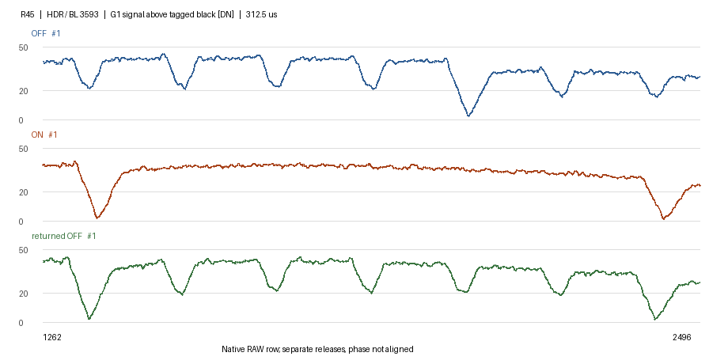

# R45: можно ли измерить штатный Flicker prevention в HDR на низком приводе?

**Да. На BL 3593 штатный ON подавил мелкую периодическую рябь, но не широкий провал.** На 500 мкс полуамплитуда ряби до/после ON составляла около 18%, внутри ON — ниже порога измерения. На 312,5 мкс в ON ширина отдельного провала на половине глубины — **39,5–42,5 RAW-строки**, а глубина — **92,59–95,10%**. Профиль не проходит цель 3–5%; численная частота PWM не установлена.

В [R44](../direct_camera_r44_20261121/result.md) при BL 3593 и PQ Y′=573 все 33 коротких RAW дали меньше 20 DN над тегом чёрного. Это не было отрицательным результатом для самой панели. В R45 меняем только тестовое поле на один нейтральный максимум legal-range PQ (10 бит, Y′=940); это не запрос максимальной яркости Android. Внутри сравнения OFF/ON/возврат поле не меняется. Фактические условия требуются прежние: штатный BL **3593**, HWC **0/120**, настоящий HDR на одном полноэкранном слое без наложений, остановленная сессия `0x8e`, без температурного ограничения. Выход за эти условия — не результат по мерцанию.

**Правило до съёмки.** Nothing A001 смотрит непосредственно на XT2611-1; родной G1, фиксированная ROI R42, 1×/5,56 мм, ISO 6400. На исходном OFF — пара геометрических CAL 1,25 мс (при клиппинге отдельная пара 500 мкс) и независимые кадры на 200/312,5/500 мкс. Для перехода к ON нужен прошедший CAL и хотя бы одна короткая выдержка с ≥3 кадрами, на которой все прошли 20 DN и нет отсечения. Для вывода об изменении глубины на конкретной выдержке нужны ≥3 квалифицированных события с каждой стороны, обе вернувшиеся OFF-медианы с расхождением ≤3 п.п., эффект ON относительно каждой ≥3 п.п. и неперекрывающиеся диапазоны. Отдельно проверяем повторяющуюся мелкую волну вне широкого провала; не выводим Гц из числа RAW-строк. Если OFF не прошёл оптический допуск, настройку не включаем.

**Что именно подали.** У первого, среднего и последнего из 288 000 декодированных кадров проверены все отсчёты трёх плоскостей: `940/512/512`; 720×1584, 120 fps, HEVC Main 10, BT.2020 NCL/PQ. Перенос и мастеринг совпадают с клипом R44, в том числе заявленные mastering max и MaxCLL/MaxFALL **204/204/204 кд/м²**. Максимум кода означает 10 000 кд/м² *на эталонной PQ-кривой*, а не запрос к панели выдать 10 000 нит. Статические метаданные намеренно оставлены прежними, хотя они не описывают новый максимум растра: опыт проверяет, что делает данный тракт с таким входом, а не все варианты HDR-мастеринга. Копия на Lenovo сверена с исходным MP4 побайтно. [Проверка стимула](stimulus.json).

### Исходный OFF: короткая оптика заработала

На XT2611-1 `W3WWS36.65-64-4-1` запрос Android `0.112296231` снова дал BL **3593**. На OFF/200 мкс значения телеметрии в R44 и R45 совпали: HWC 0/120, `mHbmMode=hdr`, HDR/SDR ratio 3,01127, `displayBrightnessNits=40,9800` (показание SF, не фотометр). Пара CAL/1250 в R45 прошла допуск поля во всех четырёх четвертях, запас 20 ячеек Bayer. Так же прошли **15/15** коротких исходных кадров — без клиппинга, отсечения на нуле или среднего ниже 20 DN.

| Выдержка | Медиана G1 OFF в R44, Y′=573 | Медиана G1 OFF в R45, Y′=940 | Отношение |
|---:|---:|---:|---:|
| 200 мкс | 3,62 DN | 21,49 DN | 5,93× |
| 312,5 мкс | 5,88 DN | 33,55 DN | 5,71× |
| 500 мкс | 9,32 DN | 55,00 DN | 5,90× |
| 1,25 мс, CAL | 20,84 DN | 136,50 DN | 6,55× |

Это прямые средние над тегом чёрного в одной ROI при одной выдержке и одном ISO, но разные посещения стенда, не A/B одной эпохи. Пригодность R45 установлена по его собственным оригиналам и [предварительно заданному допуску](pilot.csv), а не по этому отношению. Для разрешения ON не требовалось заранее найти глубокий минимум.

**Дополнительный различающий контроль.** Среднее выше 20 DN не гарантирует, что у *конкретного* минимума достаточно светлые соседние строки: на первых пяти ON/200 локальное плато не прошло допуск R43. Основную меру не ослабляем. Отдельно проверяем другой наблюдаемый эффект: меняется ли свет в **одном и том же месте** между пятью спусками на той же выдержке? Делим фиксированную ROI на 124 неперекрывающиеся полоски по пять строк ячеек G1. В каждой полоске выбираем самый светлый и самый тёмный спуск по чётным столбцам; на нечётных считаем `100×(1−тёмный/светлый)` для той же пары, затем меняем столбцы ролями. Берём меньшую из двух оценок, только если обе светлые опоры ≥20 DN. Публикуем медиану, P90 и количество полосок с падением ≥50% без выбора удобной строки. Это изменение среднего фиксированного участка между спусками, не локальная глубина одиночной полосы, не измерение всего периода и не тест на частоту. Если фаза затвора повторилась, размах может быть занижен.

### Что именно изменил переключатель (`confirmed-on-target`)

**51 оригинальный DNG в 12 закрытых окнах**, в одной эпохе и при одном и том же видеослое. На всех 24 границах: HWC 0/120, `HDR` в HWC/SDM, BL 3593 и `panelDC`/provider соответственно 0/0 → 1/1 → 0/0. Все три пары CAL прошли геометрию; медиана их средних над чёрным **136,50 → 137,54 → 137,05 DN** (ON к исходному OFF: +0,77%). При наблюдении без переключения исходящих пакетов нет; при ON и OFF — точное совпадение со своей штатной 75-пакетной таблицей, по одному `dsi_panel_send_param_cmd rc=0`, без пропусков наблюдателя. Это свидетельство отправки, не чтение содержимого DDIC. [Окна](windows.csv) · [геометрия](geometry.csv) · [отправки](dispatch.csv).

**Мелкая рябь вне широких провалов.** В таблице — оценка полуамплитуды первой гармоники в % от местного плато на заранее заданном пространственном шаге [R35](../direct_camera_r35_20261120/result.md), 177,35 RAW-строки. Это не глубина всего светового сигнала. Свободный поиск дал шаг 176,6–178,0 строки в 14/15 начальных OFF и 15/15 возвратных кадров; в ON не подтвердил повторяющуюся компоненту ни в одном из 15. На фиксированном шаге все 15 оценок ON **ниже своего порога**. Пустые оценки не заменяются нулями. [Покадровые пороги, число повторов и подгонки](fine.csv).

| Выдержка | OFF, медиана | ON, оценка ниже порога | Возврат OFF, медиана |
|---|---:|---:|---:|
| 200 мкс | 21,40% (4 оценки) | 0,46% | 21,71% |
| 312,5 мкс | 20,55% | 0,33% | 20,84% |
| 500 мкс | 17,94% | 0,37% | 18,27% |

При 500 мкс независимая привязка к шагу первого кадра R45 OFF дала **17,73–18,27% → 0,24–0,61% → 17,67–18,31%**, пороги внутри ON 1,65–2,02%. Смена действительно подавила наблюдаемую компоненту, а не просто снизила среднюю яркость. Значение 0,37% нельзя выдавать за измеренную остаточную модуляцию дисплея.



**Широкий провал сохранился.** При ON на 312,5 мкс **4/5** локальных событий прошли проверку G1 и обеих горизонтальных половин: медиана глубины **94,05%**, диапазон 92,59–95,10%, медиана ширины **41,42 RAW-строки**. В одном из этих кадров две независимо измеренные опоры в ±177,35 строки дали 38,45 и 37,83 DN против **2,38 DN** в центре. На ON это проверка на контрольном шаге R35, а не свидетельство, что в ON осталась рябь именно с таким шагом. На начальном OFF при 200 мкс прошли 5/5 (96,28–99,02%), но при 312,5 мкс локальные плечи на фоне ряби не прошли критерий контраста. На возврате при 312,5 мкс прошли 4/5 (91,82–92,53%). **Ни на одной выдержке нет ≥3 квалифицированных локальных событий сразу во всех трёх состояниях**: нельзя утверждать точную величину изменения глубины OFF→ON. Нельзя и принимать отсутствие годных событий в группе за ровный свет. [Все кадры и статусы](frames.csv) · [основное сравнение](compare.csv).

Проверка одного места между спусками на 312,5 мкс прошла порог яркой опоры во всех 124 полосках в каждой фазе. Медианный наблюдаемый размах упал с **42,09% до 3,50%** и вернулся к **42,97%**. Но P90 остался **76,92 → 77,41 → 80,96%**; даже в ON в **26 из 124** полосок в этих пяти спусках свет падал минимум вдвое. Низкая медиана не описывает редкий глубокий провал. [Результаты на всех выдержках](repeat.csv).

**Граница по частоте.** Расстояние в строках — не время. В исходных OFF-кадрах опоры ± один шаг мелкой ряби могут сами оказаться в её тёмной части. Интервалы между пороговыми минимумами не идентифицируют автоматически две соседние *широкие* полосы. Поэтому не переносим на R45 ни частоту из SDR/R35, ни временной масштаб из высокого HDR/R44. [Проверка идентичности и геометрии интервалов](timing.csv). Приведённые проценты — камерные метрики на названной выдержке, а не реконструкция мгновенной светимости OLED.

Внутри ON, где мелкая волна не разрешилась, отдельно применили исходный критерий размытия R43. Пары **200/500 и 312,5/500 мкс** дали собственный эффективный градиент **7,9 и 7,7 мкс/RAW-строку** соответственно. Но в этих кадрах ни одна пара соседних событий не прошла независимые требования к границам и светлым плечам в обеих половинах ROI. [Проверка ON](on-scale.csv) возвращает `too_few_within_frame_spacings`, а не численную частоту.

**Один минимум в двух местах того же RAW.** Дополнительно на пяти исходных OFF/200 проверены границы половины глубины у G1 по двум разнесённым колонкам изображения. При разносе 250 RAW-столбцов обе зоны проходят CAL и ≥20 DN во всех пяти кадрах; центр на стороне с большим x ниже по номеру RAW-строки на **0,55–1,96 строки**, а интервалы половины глубины перекрываются на **40,17–42,53 строки**. На базе 700 столбцов сдвиг больше (4,04–6,07 строки), но одна зона ниже 20 DN: только диагностика формы, не допуск амплитуды. Полоса общая для двух зон; небольшой наклон в координатах сенсора не определяет ни направление сканирования панели, ни частоту. [Покадровые пары и допуски](spatial.csv).

**Возврат.** Перед запуском обычная политика Android была в `DIM` при ручных 102 (BL 828); обычное событие активности без смены настройки вернуло `BRIGHT`, BL 6692. Сессия остановлена с подтверждением штатных регистров. Перед серией на Lenovo отдельно проверен локальный таймер в контрольном OFF. По окончании — Settings, ручные 102/BL 6692, min/peak `120.0/0`, `panelDC=0`, provider OFF, Extra Dim отсутствует; сессия `running / active: verified` в новой эпохе wake. Удалены только собственные видео и временный таймер/скрипт, логгер выключен, своих probes и trace instance не осталось, thermal 0 без override. S и ISO A001 возвращены в Auto, затем `PHOTO 2×`. Пробы глазами, flash и новых произвольных DSI-последовательностей не было.

**Следующий различающий опыт.** Оставить подавленную мелкую волну (штатный ON/3593), фиксированный измеримый PQ-растр и проверить, меняются ли **ширина и повтор широкого провала** при реально достигнутом стандартном HWC **120 → 144 → 120**. Это не повтор R35: там при 3600 на штатном OFF измерялась в первую очередь мелкая волна; здесь на ON её вклад ниже порога. Сначала проверить удержание HDR/BL, фактический HWC на границах и свет; длинную область для двух событий принимать только после своей геометрической проверки, временной масштаб выводить из выдержек в каждом режиме. Если Android/плеер не допускает сопоставимый 144 или в кадры не попадают независимые пары — зафиксировать ограничение, не форсировать панель и не выдавать 144 за частоту PWM.

Воспроизведение по приватным оригиналам и квитанциям из корня worktree:

```sh
d=artifacts/direct_camera_r45_20261121; r=artifacts/direct_camera_r44_20261121
e=../../private-bench-evidence/direct-r45-20261121; export OPENBLAS_NUM_THREADS=1
python3 -B "$d/pilot.py" "$e/frames" | diff -u "$d/pilot.csv" -
python3 -B "$r/measure.py" "$e/frames" | diff -u "$d/frames.csv" -
python3 -B "$d/windows.py" "$e" "$d/frames.csv" | diff -u "$d/windows.csv" -
python3 -B "$d/compare.py" "$d/frames.csv" "$d/windows.csv" | diff -u "$d/compare.csv" -
python3 -B "$r/geometry.py" "$e/frames" --required-scenes offLow onLow retLow | diff -u "$d/geometry.csv" -
python3 -B "$r/dispatch.py" "$e" | diff -u "$d/dispatch.csv" -
python3 -B "$d/repeat.py" "$e/frames" "$d/windows.csv" | diff -u "$d/repeat.csv" -
for x in fine timing spatial; do python3 -B "$d/$x.py" "$e/frames" | diff -u "$d/$x.csv" -; done
python3 -B "$d/timing.py" --on-blur "$e/frames" | diff -u "$d/on-scale.csv" -
```
