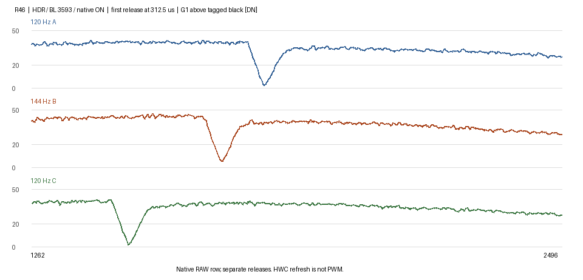

# R46: широкий провал на HDR/3593/ON при 120 → 144 → 120 Гц

**Итог: переход в реальные 144 Гц немного сужает наблюдаемый провал, но не устраняет его.** При ON и неизменном приводе на 200 мкс основная метрика даёт **93,41–96,39%** глубины в 6 из 8 кадров на 144 Гц. На 312,5 мкс видимая длительность на полуглубине по размытию на исходной длинной полосе — примерно **368 → 351 → 370 мкс**. Это ширина после интеграции камерой, не время полного выключения OLED. Ни режима с остатком 3–5%, ни PWM ≥2000 Гц без глубокого провала здесь нет в числе подтверждённых результатов.

**Вопрос.** В [R45](../direct_camera_r45_20261121/result.md) штатный ON обратимо подавил мелкую волну на BL 3593, но на 312,5 мкс остался провал 92,59–95,10%. Проверяем не название режима, а то, меняются ли ширина и повтор этого провала при переходе между двумя реальными развёртками. Обычно SF для HWC 0 сообщает 120 Гц, для HWC 1 — 144 Гц. Значение `renderFrameRate` приложения, список поддерживаемых режимов и уставки Android сами по себе переход не доказывают.

**Условия до съёмки.** Перед включением Flicker prevention остановить сессию `0x8e` с подтверждением stock; запросить низкую яркость стандартным Android API, оставить один нейтральный PQ-растр Y′=940. В пилоте OFF установить, достижимы ли обе развёртки на одном клипе; при необходимости попробовать обычное пользовательское предпочтение режима и один клип с 24 fps, общим делителем 120 и 144. Не подменять недостижимый 144 результатом из SDR. Для зачётной тройки: один непрерывный PQ-слой, одна эпоха, одинаковый BL 3593, настоящий HDR/HBM, один полный переход в штатный ON перед тройкой и OFF после неё, `provider` и `panelDC=1` внутри. На каждой границе проверять SF, SDM, foreground, отсутствие наложений и теплового ограничения. Если фактический режим или свет не удерживаются — сообщить предел сравнения. Собственные сырые команды панели не отправлять.

**Оптика.** A001 снимает непосредственно Lenovo: ISO 6400, 1×, родной G1. Каждая фаза получает собственную пару CAL 1250 мкс и короткие RAW на 200/312,5/500 мкс. Основная ROI неизменна относительно R45. Отдельная длинная ROI годится для временной оценки только после независимой проверки поля; межсобытийный интервал в RAW-строках сам по себе не частота. Сопоставимость света — средний G1 на CAL до ±5%; количественный вывод о разнице глубины требует ≥3 годных событий в каждой фазе одной выдержки, отличие медианы от каждой 120-фазы ≥3 п.п. и неперекрывающиеся диапазоны при возврате 120-медиан в пределах 3 п.п.

**Пилот и решение до просмотра B-оптики.** На исходном 120-fps клипе R45 достаточно штатных `peak=144`, затем `min=144`: HWC 1/144 и текущий HDR получены при BL 3593, хотя видеослой всё ещё голосовал `120 ExactOrMultiple / OnlySeamless`. Возврат: сначала `min=120`, затем `peak=120`. Предпочтение пользователя для display 0 не меняли; резервный 24-fps файл подготовлен офлайн, но не загружался на Lenovo. Первая пара A/1250 при среднем 137,0–137,3 DN имела **15** не покрытых двумя снимками строк в области с запасом, без отсечения и без боковых затенений. Не снижаем порог геометрии и не выбираем удобные спуски. Для независимого повторного входа в *целую* тройку заранее добавляем по паре **4 мс** только для проверки освещённого поля в каждой фазе, сохраняя CAL 1250 для сравнения света и короткие выдержки для провалов. Проходы не объединяем в одну эпоху.

Во втором проходе отдельно от CAL снимаем шесть DAY на 1250 мкс для временного масштаба по размытию. Это даёт вторую, более разнесённую по экспозиции проверку `312,5/1250` и `500/1250`, не подменяя ей ширину на коротком RAW. Рассматривать её как временной масштаб можно только при согласовании двух годных оценок в пределах 10%; конфликт с годным коротким масштабом не разрешается выбором удобного ответа. Привязка к Гц HWC в подгонку не вводится.

**Первый проход (`confirmed-on-target`).** 60 прямых RAW / 12 закрытых окон: одна поверхность с возрастающим номером показанного видеокадра, фактический HWC **0 → 1 → 0**, HDR/3593 и `panelDC=1` во всех измерительных окнах. На границе в 144 — точные **10/10** LP-пакетов штатного `timing@1`, на возврате — **14/14** `timing@0`. В обоих случаях следом за явным выбором страницы 00 отправлен `51 0e 09` (**3593**), не только совпало значение в sysfs. Отдельные ON и OFF совпали со своими 75-пакетными таблицами. Совпадение TX не является покомандным readback DDIC. В пилотных переходах при DC OFF получены те же mode/DBV отправки. [Запрос и реальный режим](initial_policy.csv) · [журнал совпадений с выбранным BOE v4](initial_switch.csv) · [первичные окна](initial_windows.csv).

На первой A/1250 не прошла и заранее выбранная длинная полоса: 53 непокрытые строки с запасом (на B и C — ни одной). Для этой тройки не публикуем оптическую разницу A/B/C или временной масштаб, хотя аппаратный переход независимо подтверждён. [Исходная ROI](initial_field.csv) · [длинная ROI](initial_strip.csv). Координаты длинной полосы `[580:1365,725:790]` зафиксированы на предыдущих R45 RAW; её свет и достаточное число повторов проверяются заново внутри каждого режима, не заимствуются у R45.

### Сопоставимый повтор на железе

На XT2611-1, `W3WWS36.65-64-4-1`, получены **102 прямых DNG / 18 окон в новой эпохе**. На всех 36 границах один и тот же непрозрачный PQ-видеослой, другие видимые слои отсутствуют, HDR подтверждён в HWC и SDM, `HBM=hdr`, `panelDC=1` и provider=1. Номер показанного кадра на той же поверхности увеличивался в каждом окне на 1259–4441 без регрессии между окнами; это не оценка fps. Ещё раз совпали 75-пакетные OFF/ON и обе штатные последовательности переключения режима с повтором `51 0e 09`. [Привязка окон](windows.csv) · [политика и голос плеера](policy.csv) · [фактические отправки](switch.csv).

Обе области измерения прошли независимую [геометрию на 4 мс](field.csv), [в том числе длинная полоса](strip.csv). Средний G1 над тегом чёрного в парах CAL/1250 составил **137,63 → 138,50 → 134,44 DN** у A/B/C. Максимальная разница **3,02%**, внутри допуска 5%; контрольные средние CAL/4 мс **438,84 → 439,18 → 440,39 DN**. Это измеренный камерой свет, не паспортные ниты.

| На выдержке 312,5 мкс | 120 A | 144 B | 120 C, возврат |
|---|---:|---:|---:|
| Глубина по двум фронтам и светлым опорам, медиана | 92,03% | **86,07%** | 92,68% |
| Ширина на полуглубине по тем же кадрам, RAW-строки | 48,05 | 48,81 | 47,16 |
| Квалифицированные кадры этой проверки | 8/8 | 8/8 | 7/8 |
| Видимая ширина на длинной полосе, мкс, медиана отдельных спусков | 367,5 | **350,7** | 370,5 |
| Годные спуски для временной ширины | 8/8 | 8/8 | 6/8 |

Первая проверка использует фиксированную ROI R42, наблюдаемые фронты и собственные светлые опоры с каждой стороны провала ([алгоритм](width.py), [по кадрам](width.csv)). На 500 мкс медианы глубины **70,88 → 66,03 → 70,54%** (8/8 во всех фазах). Это поддерживает умеренное и обратимое ослабление после интегрирования, не плоский свет. Изначальная метрика локального минимума R43 не дала ≥3 годных событий во **всех** фазах ни на одной выдержке: нельзя выдавать результат по двум фронтам за прохождение первичного критерия разницы глубин. На 200 мкс у B основная метрика всё же напрямую разрешила почти полное гашение. [Основное сравнение с отказами](compare.csv) · [все RAW-метрики](frames.csv).



**Мелкая волна не вернулась.** В свободном поиске повтор в полосе 105–315 RAW-строк не подтвердился ни в одном из 72 коротких кадров. На заранее известном шаге 177,35 все 72 оценки ниже своего порога; в частности, на 144/500 мкс медианная оценка полуамплитуды **0,32%**, не достоверная абсолютная глубина модуляции. Проверен и отдельный шаблон 188,50 строки из R35/144. [Чувствительность и число повторов для каждого кадра](fine.csv).

### Временной масштаб и повтор — разные измерения

На исходной длинной полосе эффективный градиент из размытия **7,8 / 7,4 / 8,1 мкс на RAW-строку** у A/B/C. Для A расчёт опирается на независимые DAY/1250; при B и C короткая и длинная калибровки согласуются. На 312,5 мкс у B разброс видимой ширины по спускам **345,5–357,1 мкс**, у A **354,2–380,6**, у C **364,0–377,9 мкс**. Число RAW-строк нельзя сравнивать как время без такой проверки в каждом режиме; FWHM короткого RAW не является мгновенной шириной электрического импульса.

В исходной полосе есть два кадра B с расстоянием между центрами примерно 923 строки и отдельные кадры C с расстоянием порядка 1064–1066 строк. Ни в одной фазе не набралось двух годных пар со всеми требуемыми светлыми опорами и внешним запасом 100 Bayer-ячеек. Поэтому **первоначальная проверка не выдала периода**: перемножать эти расстояния с градиентом и называть результат частотой PWM нельзя. [Все подгонки, фронты и причины отсева](timing.csv).

**Можно ли восстановить период из большей области тех же RAW?** Во вторичной проверке использованы только снимки CAL/4 мс фаз A и B для выбора максимального непрерывного расширения по вертикали (шаг 10 ячеек, та же полоса по x, те же пороги), затем одна отложенная проверка на C. Ни один короткий DAY не участвовал в выборе координат. Допуск получила `[580:1385,725:790]`, всего на 20 Bayer-ячеек длиннее; для неё заново вышли масштабы **7,8 / 7,4 / 8,0 мкс/строку**. С прежними требованиями к событиям на возврате появился **один** годный интервал **1066,294 RAW-строки** (`day_on120C_312__5`), на A и B — ни одного. Это один кадр вместо требуемых ≥2 на состояние, поэтому и вторичная проверка **не установила период**. [Выбор только по CAL и отложенный контроль](extended.csv) · [пересчёт без ослабления критериев](extended_timing.csv).

**Возврат стенда.** Всего 162 независимых DNG; оригиналы и полные системные дампы оставлены приватными. Каждый проход закончился выходом из плеера, штатной таблицей OFF и новой проверенной эпохой владельческой сессии. После второго: Settings, manual 102, BL 6692, min/peak `120.0/0`, `panelDC=0`, provider OFF, Extra Dim отсутствует. Предпочтение display 0 осталось `1440×3168@120.00001`, глобальное — `null`; термостат 0 без override. Созданные видео, таймер, его скрипт и собственная MIPI-трасса удалены; логгер выключен. A001: S/ISO снова Auto, затем PHOTO 2×. Без flash и пробы глазами.

**Следующий рычаг — не новая частота HWC.** Проверить, достижима ли штатная ветка ограничения мощности панели **APL** обычной ручной регулировкой при уже работающем HDR. [В выбранном DT и драйвере](../brightness_policy_recon_20261107/result.md) первая возможная команда ON — при **DBV >16000**, а в [реальном SDR](../direct_camera_r36_20261120/result.md) даже максимальная ручная установка дала лишь 14078. В снимках R46 `mBrightnessMax` перед клипом — 0,98787487, в HDR — 1,0 при тех же `mBrightnessMaxRaw=1.0` и `mBrightnessMaxCap=0.98787487`; это **не** измеренный аппаратный максимум. На следующем этапе сначала коротко проверить физический DBV и пассивную отправку именно штатной APL-таблицы вверх и обратно на том же клипе. Если граница или отправка не наблюдается — не форсировать APL, ничего не писать в DDIC; если наблюдается — только тогда сопоставить короткие RAW по сторонам этой другой аппаратной границы. Отдельно проверить возврат; вывод о вечернем свете R46 не переносить.

Воспроизведение подтверждающего прохода из корня рабочего дерева с приватными оригиналами:

```sh
d=artifacts/direct_camera_r46_20261121; r=artifacts/direct_camera_r44_20261121
e=../../private-bench-evidence/direct-r46-20261121/confirm; export OPENBLAS_NUM_THREADS=1
python3 -B "$r/measure.py" "$e/frames" | diff -u "$d/frames.csv" -
python3 -B "$d/windows.py" "$e" "$d/frames.csv" | diff -u "$d/windows.csv" -
python3 -B "$d/compare.py" "$d/frames.csv" "$d/windows.csv" | diff -u "$d/compare.csv" -
for x in field strip; do python3 -B "$d/$x.py" --field-us 4000 "$e/frames" | diff -u "$d/$x.csv" -; done
python3 -B "$d/fine.py" "$e/frames" | diff -u "$d/fine.csv" -
python3 -B "$d/width.py" --releases 8 "$e/frames" | diff -u "$d/width.csv" -
python3 -B "$d/timing.py" "$e/frames" "$d/strip.csv" | diff -u "$d/timing.csv" -
python3 -B "$d/extended.py" "$e/frames" | diff -u "$d/extended.csv" -
python3 -B "$d/timing.py" --extended "$e/frames" "$d/extended.csv" | diff -u "$d/extended_timing.csv" -
for x in policy switch; do python3 -B "$d/$x.py" "$e" | diff -u "$d/$x.csv" -; done
```
