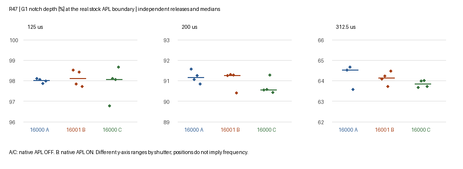

# R47: достигается ли заводской переход APL в настоящем HDR?

**Да, но он не убрал широкий провал.** На реальной границе **16000 → 16001 → 16000** обе штатные команды APL точно идентифицированы и возвращены. На 125 мкс медиана глубины G1 составила **98,03 → 98,13 → 98,08%**. На 312,5 мкс изменение при включении относительно среднего двух OFF — **−0,04 п.п.** В этой яркой точке нет ни целевых 3–5%, ни оснований пробовать профиль глазами.

После [R46](../direct_camera_r46_20261121/result.md) проверяем иную ветвь драйвера, не ещё одну развёртку. В [отобранном BOE v4](../brightness_policy_recon_20261107/result.md) `dsi_panel_set_apl` выбирает ON при DBV **строго выше 16000**, исходном OFF и нулевом Dolby gate; ниже или на пороге возможен возврат. Штатные APL и HBM имеют общие байты, но это не одна команда. Максимум ручного SDR ранее оказался [14078](../direct_camera_r36_20261120/result.md); его не переносим на HDR и не обходим. Проверка проводится на лабораторном XT2611-1, исходная настройка Flicker prevention OFF, сессия владельца остановлена и проверена.

**Условие действия до подачи яркости.** Не форсировать HBM, APL, thermal или ALS; только Android `cmd display set-brightness` на работающем видео. Один нейтральный PQ Y′=573 при 120 fps, тот же проверенный поток, что в [R44](../direct_camera_r44_20261121/result.md). Это не тест площадью белого. На границах требуем текущий HDR HWC/SDM, единственный непрозрачный видеослой, HWC 0/120, стабильный фактический BL, нормальный thermal. В пилоте — фиктивная установка, расчётная нижняя и верхняя точки и возврат. Если верхняя не пересекает порог, коротко проверить предел обычной ручной команды. Высокая уставка не удерживается в ожидании анализа или переноса RAW: для каждого выхода действует отдельный невозобновляемый таймер на Lenovo. До первого высокого уровня проверяется реальный автоматический возврат на низком контрольном уровне.

Сам по себе `BL>16000` не доказывает APL. До оптики требуются фактические штатные последовательности ON и OFF, контекст штатного отправителя и возврат вниз без ошибки. Только тогда имеет смысл сравнить короткие RAW в ближайших воспроизводимых кодах около порога при одном поле и возврате. Новые произвольные DSI-команды, прошивка и проверка глазами не входят в раунд.

### Достижимость на обычном Android (`confirmed-on-target`)

На GLOBAL `W3WWS36.65-64-4-1` один полноэкранный HDR-клип, 120 Гц и ручная яркость дали:

| Запрос Android | Установившийся sysfs BL | Фактический переход |
|---:|---:|---|
| 0,39799744, затем такая же уставка | 13119 | Повтор без APL-пакетов |
| 0,69282955 | 15513 | Ниже порога, без APL |
| 0,7534553 | **16148** | APL ON при промежуточном DBV **16046** на подъёме |
| 0,39799744 | **13119** | APL OFF при промежуточном DBV **15990** на спуске |

В нужных интервалах — точные массивы выбранного DT: ON **4/4 LP**, OFF **3/3 LP**, не HS-префиксы HBM. Совпали запись OEM `threshold=16000 state=1/0` и переданный драйверу уровень. В каждом интервале один возврат `dsi_panel_tx_send_mot_cmd` из `dsi_panel_set_apl`, оба `rc=0`, без пропусков. После явного выбора страницы `00` виден `51` соответственно на 16046/15990. Это разные вещи: **16046/15990** — уровни первого зарегистрированного переключения во время рампы, **16148/13119** — установившиеся значения в данном опыте. Максимум аппарата не искали; запрос `1.0` не понадобился. [Текущая HDR-политика](reach_policy.csv) · [пассивная трасса](reach_dispatch.csv).

В отдельном входе [девять кратких проверок штатного ползунка](fit.csv) дали точные соседние коды: `0.726206468` → **15999**, `0.726275145` → **16000**, `0.726412781` → **16001**, `0.726481599` → **16002**. У каждой точки три последовательных чтения установившегося DBV; кандидат проверяется снова при каждой используемой оптической уставке. Это локальная карта для данной сцены и политики, а не рецепт по универсальной нормировке float. На плато 16000 оказались как `0.726343963`, так и `0.726275145`.

**Сравнение у границы.** На каждой выдержке отдельная ограниченная тройка **16000 → 16001 → 16000** (A/B/C); после неё — возврат к BL 13119 до переноса файлов, без выхода из текущего HDR-клипа. `off` в именах снимков относится только к *Flicker prevention*: в B его provider и `panelDC` по-прежнему 0, а ветвь APL включается. Точки сравнения — G1 над тегом чёрного при ISO 6400/5,56 мм, фиксированная ROI R42 и собственные пары CAL на каждую фазу. Первые пары на 1250 мкс клиппировали во всех состояниях; они сохранены, но не используются для вывода о свете. Все четыре четверти независимых пар на 500 мкс прошли штатный допуск во всех трёх фазах. Годный локальный минимум нужен в ≥3 независимых спусках каждой фазы данной выдержки; полезный шаг требует сдвига медианы ≥3 п.п. относительно обеих сторон возврата и неперекрывающихся диапазонов. Глубина и FWHM считаются раздельно, ширина RAW-полосы не является аппаратным off-time.

### Свет на одном шаге DBV (`confirmed-on-target`)

В основном проходе **48 DNG / 15 окон** на одной поверхности и в одной эпохе. На обеих границах каждого окна HWC 0/120 с реальным HDR в HWC и SDM, температура в норме, счётчик кадра плеера вырос на 754–1153. На пяти подъёмах к 16001 и пяти возвратах к 16000 проверены полные APL ON и OFF, порог и уровень из OEM-журнала, вызов штатного отправителя и `rc=0`. Не было HBM-подмены или переопределения яркости при переносе RAW. Исходный OFF до первой команды — вывод из низкого DBV и истории, а не прямое чтение памяти DDIC. [Окна и выдержки](windows.csv) · [отправки](dispatch.csv) · [соответствие состояния каждой фазе](history.csv).

На общем годном CAL/500 средние G1 над тегом чёрного **336,63 → 334,89 → 338,05 DN**, максимальная разница **0,94%**, все три сравнения укладываются в ±5%. [Клиппированные CAL/1250](field1250.csv) · [независимые CAL/500](field500.csv).

| Выдержка | Медиана глубины, APL OFF → ON → OFF | ON минус среднее двух OFF | Кадров с годным минимумом |
|---|---|---:|---|
| 125 мкс | 98,03 → **98,13** → 98,08% | +0,08 п.п. | 4, 4, 4 |
| 200 мкс | 91,16 → **91,27** → 90,55% | +0,41 п.п. | 4, 4, 4 |
| 312,5 мкс | 64,53 → **64,15** → 63,86% | −0,04 п.п. | 3, 4, 4 |

Диапазоны при переключении перекрываются. На 125 мкс четыре ON-кадра дали **97,73–98,52%** провала. Изменение медианы ширины на половине глубины относительно среднего двух OFF: **+0,16 / +0,26 / +0,77 RAW-строки** для трёх выдержек. Независимый алгоритм по двум фронтам также не показывает практически полезного уменьшения: на 125 мкс его медианы глубины **97,05 → 97,16 → 96,88%**, ширины **26,48 → 26,29 → 26,36 строки**. На длиннее интегрирующем кадре провал выглядит мельче во всех фазах; это не улучшение APL. [Исходные метрики](frames.csv) · [сравнение с проверкой света](compare.csv) · [два фронта](width.csv).



**Частота.** По размытию в основной ROI локальные эффективные градиенты составили 7,8–8,0 мкс на RAW-строку, но ни одна пара выдержек одного состояния не дала двух независимых годных интервалов между соседними провалами. Это не измерение частоты PWM и не доказательство отсутствия более быстрых составляющих. [Проверка масштаба и повторов](timing.csv).

На заранее выбранной в R46 **длинной полосе** `[580:1365,725:790]` (без нового поиска по R47) собственные CAL/500 подтвердили освещённость во всех трёх фазах. Здесь при **APL ON / 16001** в двух независимых спусках на 125 и 200 мкс измерены промежутки **1063,94 и 1065,30 RAW-строк**. Две калибровки по размытию этой же фазы прошли; при масштабе 8,0 мкс/строку получается **условный период широкого провала около 8,52 мс (≈117 Гц)**. В подгонку не подставлялись 120 Гц дисплея. Оценка предполагает одинаковые следующие друг за другом события и местное постоянство градиента развёртки. В A/C — 0/1 годных кадров с интервалом: сравнение периода APL OFF и ON не выполнено. Это оценка видимой огибающей, **не частота высокочастотной несущей OLED**. [Длинная полоса, допуски и оба интервала](longcheck.csv).

### Контроли: имеет ли значение именно переход порога?

Независимый вход, **48 DNG / 14 окон**, тот же PQ, HWC 0/120, штатный Flicker prevention OFF. У каждого DBV 15999–16002 своя пара годных CAL/500; средние **334,55 / 335,81 / 334,43 / 338,33 DN**, размах относительно минимального значения 1,17%. Направление входа менялось, а HBM-команд по-прежнему нет. В повторе команды на 16000 не было ни APL ON, ни APL OFF.

| Сравнение, 312,5 мкс | Уровни DBV | Δ глубины по двум фронтам, п.п. | Δ FWHM, RAW-строки |
|---|---|---:|---:|
| Включение APL (основной проход) | 16000 → 16001 → 16000 | −0,44 | +0,24 |
| Один шаг внутри OFF | 15999 → 16000 → 15999 | +0,28 | −0,30 |
| Один шаг внутри ON | 16002 → 16001 → 16002 | −0,32 | +0,42 |
| Выключение APL в середине | 16001 → 16000 → 16001 | +0,16 | −0,07 |
| Та же команда, без смены уровня | 16000 → 16000 | +0,12 | +0,18 |

Для троек Δ — медиана средней фазы минус среднее двух крайних медиан; для повтора — вторая минус первая. Каждый расчёт имеет ≥3 годных спусков на фазу. На этом наборе оптические различия перехода того же порядка, что и обычные одношаговые контроли, а в обратной тройке нет большого обратимого скачка. Это ограничивает именно **установившийся широкий провал на данном поле**. Не исключены переходный эффект, изменение потребления, иной режим/цветовой код или меньший эффект; внутренние регистры после каждой отправки не перечитывались. [Сравнения](edges.csv) · [контрольные оригиналы: метрики](control_frames.csv) · [привязка](control_windows.csv) · [состояния по истории](control_history.csv) · [TX](control_dispatch.csv).

**Возврат и объём.** 96 уникальных прямых DNG в двух измерительных эпохах; широкая и узкая проверка достижимости шли отдельно, не выдаются за оптические повторы. Перед верхними уставками на безопасном нижнем уровне проверена автономная отмена: BL 5148, затем по локальному дедлайну BL 6692 и независимая проверка после 10 с. В основном и контрольном измерениях девять отдельных невозобновляемых окон; от отметки перед первым запросом до проверки низкого DBV 13119 прошло **39,3–63,3 с** на окно. Эти длительности включают и возврат, это не измерение времени HBM ON и не заявленная безопасная длительность. Во время переноса RAW верхняя уставка уже снята. В последнем возврате наблюдалась заводская APL OFF; после выхода из клипа — HBM off, manual `0.39799744` / 102, BL 6692, Settings, min/peak `120.0/0`, `panelDC=0`, provider OFF, Extra Dim отсутствует, `active: verified` в новой эпохе. Убраны собственные ролики, таймер и наблюдатель, MIPI-журнал выключен, thermal 0 без override. A001 — S/ISO Auto, затем `PHOTO 2×`. Без flash и пробы глазами. Вечерний свет данным R47 не измерялся.

**Следующий отдельный опыт.** Не повторять APL с иной верхней уставкой. В обычном SDR проверить единственный именованный участок **14056**: он указан как `brightnessRange` в [конфигурации компенсации ALS](../current_display_path/als/als_comp_config.xml) и встречается в [архивной таблице выбранной панели](../dbv_band_map_20261118/result.md), но это не доказательство ступени эмиссии. В R36 подтверждён ручной максимум 14078, а не соседние коды. Сначала проверить достижимость 14055–14058; затем, только при воспроизводимых уставках, снять оба возможных стыка вокруг 14056, соседний контроль и возврат при фактических SDR/120, HBM off. Существенный результат — скачок формы, отделимый от внутриветвевого шага и дрейфа. Не использовать неизвестные байты DDIC.

**Воспроизведение из рабочего дерева** (приватные дампы и оригиналы не публикуются):

```sh
d=artifacts/direct_camera_r47_20261121; r=artifacts/direct_camera_r44_20261121
b=../../private-bench-evidence/direct-r47-20261121; e=$b/optics; c=$b/control; export OPENBLAS_NUM_THREADS=1
python3 -B "$d/policy.py" "$b" | diff -u "$d/reach_policy.csv" -
python3 -B "$d/dispatch.py" "$b" | diff -u "$d/reach_dispatch.csv" -
python3 -B "$r/measure.py" "$e/frames" | diff -u "$d/frames.csv" -
python3 -B "$d/windows.py" "$e" "$d/frames.csv" | diff -u "$d/windows.csv" -
python3 -B "$d/dispatch.py" "$e" | diff -u "$d/dispatch.csv" -
python3 -B "$d/history.py" "$e" "$d/windows.csv" "$d/dispatch.csv" | diff -u "$d/history.csv" -
python3 -B "$d/field.py" "$e/frames" --us 500 | diff -u "$d/field500.csv" -
python3 -B "$d/compare.py" "$d/frames.csv" "$d/windows.csv" --field-clipped-1250 | diff -u "$d/compare.csv" -
for x in width timing longcheck; do python3 -B "$d/$x.py" "$e/frames" | diff -u "$d/$x.csv" -; done
python3 -B "$r/measure.py" "$c/frames" | diff -u "$d/control_frames.csv" -
python3 -B "$d/controls.py" "$c" "$d/control_frames.csv" | diff -u "$d/control_windows.csv" -
python3 -B "$d/dispatch.py" "$c" | diff -u "$d/control_dispatch.csv" -
python3 -B "$d/history.py" "$c" "$d/control_windows.csv" "$d/control_dispatch.csv" | diff -u "$d/control_history.csv" -
python3 -B "$d/edges.py" "$e/frames" "$d/windows.csv" "$c/frames" "$d/control_windows.csv" | diff -u "$d/edges.csv" -
```
