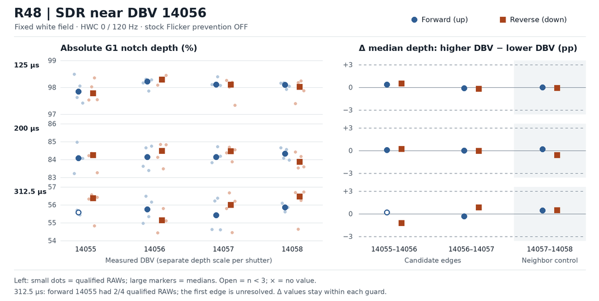

# R48 — что действительно меняется в обычном SDR около DBV 14056?

**Штатная регулировка передаёт четыре соседних кода, но по обе стороны 14056 широкого провала меньше не стало.** На белом SDR, при HWC 0/120 и HBM off, на самом DBV 14056 медиана глубины G1 при выдержке 125 мкс — **98,22% на подъёме и 98,29% на спуске**. На 125 и 200 мкс ни один из двух стыков не дал воспроизводимого скачка ≥3 п.п. При 312,5 мкс нижний стык не прошёл минимум числа годных кадров. Вывод относится к свету этого поля, а не к устройству внутренней таблицы панели и не к вечернему уровню. [Сравнения по выдержкам](compare.csv).

## Что проверено на Lenovo (`confirmed-on-target`)

XT2611-1, GLOBAL `W3WWS36.65-64-4-1`, Nothing A001. После проверки ролей использован один полноэкранный [клип](stimulus.json) 720×1584: постоянный белый `Y′/Cb/Cr=940/512/512`, 10-битный BT.709, без HDR-метаданных, 120 кадров/с. В отличие от паспортных параметров файла, [12 снимков политики](reach_policy.csv) показывают **фактические** HWC 0/120, SDR, HBM off, manual, `panelDC=0`, Flicker prevention OFF, остановленную сессию, thermal 0 без override. У одной и той же видеоповерхности продвигался счётчик кадров. Контент, настройку яркости и свет не считаем взаимозаменяемыми величинами.

| Уровень DBV | Обычный запрос Android | Последний пакет на подъёме и спуске | Установившийся BL, оба прохода |
|---:|---:|---|---:|
| 14055 | `0.865172` | `51 36 e7` | 14055 |
| 14056 | `0.865235452` | `51 36 e8` | 14056 |
| 14057 | `0.865298904` | `51 36 e9` | 14057 |
| 14058 | `0.865362356` | `51 36 ea` | 14058 |

Сначала четыре пробы независимо установили соответствие float → DBV. Затем сняты отдельные проходы от BL 6692: подъём A/B/C/D → 6692 и вход на D, спуск D/C/B/A → 6692. Во всех восьми верхних точках совпали три последовательных чтения `brightness`, последний входной `level` функции `dsi_panel_set_apl` и BE16-операнд пакета `0x51`. Каждый обычный запрос ниже текущего SDR-лимита `0.86662334` и применён без отсечки. Первые входы на A и D включают много записей рампы (80 и 81); это **не** несколько оптических повторов. Шесть соседних шагов, напротив, дают по одной записи. Контроль наблюдателя без setter не дал пакетов. Профили и границы [трасс отправки](reach_dispatch.csv) проверены; у этих пакетов в окне не наблюдался выбор страницы, поэтому `last51_page=UNKNOWN`. Вход в `dsi_panel_set_apl` не означает отправку APL. Это наблюдение хостового драйвера, не readback `00:52`, не покомандный ACK и не измерение света.

## Откуда взялось 14056 (`reported` / `hypothesis`)

[Текущий XML службы ALS](../current_display_path/als/als_comp_config.xml) задаёт `brightnessRange=14056`. [Код компенсации](../current_display_path/als/threshold_path.disasm.txt) ограничивает этим максимумом **вход модели датчика**: на 14055 → 14056 нормированная величина достигает единицы, на 14056 → 14057 она уже не растёт. Это не команда сменить режим эмиссии. То же число содержится в [архивном ряду панели `24:D0/D1`](../dbv_band_map_20261118/result.md), но пары 14056/14057 в соседнем `24:D2/D3` нет. Внутренняя семантика ряда неизвестна. Более дальнее сравнение [R36 с SDR-потолком 14078](../direct_camera_r36_20261120/result.md) не проверяло соседние коды. [R47](../direct_camera_r47_20261121/result.md) проверял другой механизм — подтверждённый порог APL в HDR на 16000/16001.

## Прямое измерение (`confirmed-on-target`)

Всего проверены **152 различные нативные RAW-плоскости**: 16 в диагностическом входе и 136 в основной серии. Для сравнения стыков использована только основная серия.

Первый запуск после электронного пилота остановился без кадров: A001 исчезла из ADB. После восстановления связи оба аппарата заново идентифицированы. Первые **16 диагностических CAL** сохранились отдельно: у всех исходных DNG тег TIFF Orientation стал `6` вместо `1`. Эти кадры не смешивали с последующей серией. Оптика, фокусное 5,56 мм, ISO 6400, мозаика GBRG, размер нативного Bayer-массива 4080×3072 и его оси сохранились. Серия ниже требует **точно `6`** в каждом оригинале и заново квалифицирует освещённость прежней области `[630:1250,754:799]` в ячейках CFA. EXIF и пиксели не переписывались и не поворачивались; исторический режим проверки по умолчанию по-прежнему требует `1`.

**Основная серия — 136 прямых RAW / 34 закрытых окна:** 32 независимых CAL и 104 измерительных кадра. В одной эпохе и на одной продвигающейся видеоповерхности получены отдельные подъём и спуск для каждой выдержки, плюс настоящий повтор идентичного запроса на 14056 при 125 мкс. Между проходами — возврат на BL 6692 до переноса оригиналов; промежуток между двумя верхними точками из разных проходов не считается непрерывным шагом. У каждой из четырёх [CAL/312,5](field312.csv) были насыщенные отсчёты в защитной области. **Единая резервная [CAL/200](field200.csv)** прошла по всем четырём кадрам каждого кода: средние G1 над уровнем чёрного **427,23 / 432,17 / 431,71 / 430,40 DN**, размах относительно минимума **1,16%** при допуске 5%.

| Выдержка | Годных DAY | Медианы глубины на подъёме: 14055 / 14056 / 14057 / 14058 | На спуске: 14058 / 14057 / 14056 / 14055 |
|---|---:|---|---|
| 125 мкс | 40/40, включая повтор | 97,84 / 98,22 / 98,10 / 98,10% | 98,02 / 98,10 / 98,29 / 97,78% |
| 200 мкс | 32/32 | 84,07 / 84,13 / 84,13 / 84,33% | 83,88 / 84,46 / 84,48 / 84,25% |
| 312,5 мкс | 29/32 | 55,57¹ / 55,75 / 55,42 / 55,85% | 56,47 / 56,00 / 55,14 / 56,37% |

¹ На подъёме при 14055 прошли только **2/4** кадра, при 14058 — 3/4; три остальных клиппировали. Нижний стык при этой выдержке не оценён по критерию ≥3 кадра на фазу. Меньшие числа на длинной выдержке — результат интегрирования камерой, не дополнительное улучшение панели. Все покадровые значения, причины отбраковки и привязки: [frames.csv](frames.csv) · [windows.csv](windows.csv).

**Разности медиан глубины, п.п.** В каждой ячейке: подъём / спуск, всегда «больший DBV минус меньший». Для выделения ступени требовались ≥3 п.п. одного знака в обоих проходах с отделением от соседнего шага и разброса повторов.



| Выдержка | 14056 − 14055 | 14057 − 14056 | Контроль 14058 − 14057 |
|---|---:|---:|---:|
| 125 мкс | +0,38 / +0,51 | −0,12 / −0,19 | −0,01 / −0,08 |
| 200 мкс | +0,06 / +0,23 | ≈0,00 / −0,02 | +0,19 / −0,58 |
| 312,5 мкс | недостаточно кадров | −0,33 / +0,86 | +0,44 / +0,47 |

Повтор уставки 14056 без смены уровня дал **−0,13 п.п.** при 125 мкс: три одинаковых чтения BL, без новой записи `0x51` и без входа в APL. В основных визитах на сам 14056 все восемь коротких кадров дали **97,86–98,45%**. [Независимое измерение ширины по двум фронтам](width.csv) прошло на 101/104 DAY: на 125 мкс разности ширины для нижнего стыка **−0,07 / −0,26 RAW-строки**, для верхнего **−0,02 / +0,08**, повтор уставки **+0,21**. Уменьшение ширины, отличимое от контроля и разброса, не установлено. Глубина и ширина — наблюдения камерой, не мгновенные параметры эмиссии.

**Полнота электронных свидетельств.** В [неисправленной таблице трасс](dispatch.csv) 37 из 43 тегов прошли автоматическую проверку, в том числе **18/18 переходов между соседними DBV** внутри дневных проходов: по одному `0x51`, согласованный `level` и три равных чтения. Пять имён `cal312_*` унаследованы от отдельного диагностического входа: в сохранённом `dmesg` под каждым именем две пары `BEGIN/END`, а не одна. Поэтому анализатор оставляет их неполными; для вывода не требуется выбирать последнюю пару на основании одного имени. При первом входе с BL 6692 на 14058 перед спуском на 125 мкс у `r44_ctrl` оказалось 82 срабатывания профиля против 81 записи трассы, при нуле зарегистрированных пропусков. Полная трасса **именно этой входной рампы** не доказана. Само плато подтверждают установившийся BL и независимые снимки до/после RAW; следующий переход 14058→14057 прошёл проверку в собственном интервале. Отказы не подменяются нулём отправок.

**Период не установлен.** На [заранее фиксированной длинной полосе](timing.csv) собственная CAL/200 прошла для всех DBV. Найдены два полных промежутка между широкими провалами: **1067,35 RAW-строки на 14058 при подъёме** и **1066,82 на 14055 при спуске**. Ни одна из восьми позиций не дала промежутков в двух независимых кадрах. Эти два числа нельзя объединить в период, а 120 Гц HWC — не частота PWM. Не исключены меньшие эффекты, переходный отклик и более быстрые составляющие; дневной кандидат не прошёл, вечернюю сцену в R48 не испытывали.

## Возврат и продолжение

В пилоте автономный таймер проверен реальным снижением BL 5148 → 6692 по локальному сроку. В основной серии все девять ярких проходов завершены при BL 6692 до локального дедлайна (35,81–65,16 с от отметки перед запросом до проверки возврата). В отдельной финальной проверке: ручная яркость 102 / BL **6692**, Settings, min/peak `120.0/0`, Flicker prevention OFF и `panelDC=0`, сессия владельца `active: verified` после нового wake, thermal 0 без override. Свой временный файл таймера удалён после побайтового сравнения; проверено отсутствие его активных меток, тестового альбома и временных probes, MIPI-журнал выключен. A001 — S/ISO Auto, затем `PHOTO 2×`. Без flash, обхода политики и пробы глазами. [Квитанции пилота и финального возврата](bench_receipts.txt).

**Следующий различающий опыт, не выполнен:** вместо ещё одного яркого стыка — [предложенный одиночный цикл на адресе `24:9E`](../em_analog_check_20261120/result.md#почему-249e-и-что-именно-предложить-владельцу), `11 → 91 → 11`, при неизменном `24:9D=8e`, белом SDR, DBV 512 и 120 Гц. Проверка отличит изменение среднего света от обратимого уменьшения широкого провала на вечернем уровне. `91` — **новый** параметр: требуется отдельное точное разрешение на обе записи, readback и откат, а также проверенный исполнитель с восстановлением. В R48 этого не делали.

Воспроизведение из рабочего дерева (приватные оригиналы не публикуются):

```sh
d=artifacts/direct_camera_r48_20261121; b=../../private-bench-evidence/direct-r48-20261121
python3 -B "$d/policy.py" "$b" | diff -u "$d/reach_policy.csv" -
python3 -B "$d/dispatch.py" "$b" | diff -u "$d/reach_dispatch.csv" -
e=$b/qualified; export OPENBLAS_NUM_THREADS=1
# dispatch возвращает 1 и сохраняет шесть обсуждаемых выше диагностических строк.
python3 -B "$d/dispatch.py" "$e" | diff -u "$d/dispatch.csv" -
python3 -B "$d/measure.py" "$e/frames" --orientation 6 | diff -u "$d/frames.csv" -
python3 -B "$d/windows.py" "$e" "$d/frames.csv" --orientation 6 | diff -u "$d/windows.csv" -
# field312 возвращает 1 из-за реального клиппинга; это диагностическая таблица.
python3 -B "$d/field.py" "$e/frames" --orientation 6 --us 312.5 | diff -u "$d/field312.csv" -
python3 -B "$d/field.py" "$e/frames" --orientation 6 --us 200 | diff -u "$d/field200.csv" -
python3 -B "$d/compare.py" "$d/frames.csv" "$d/windows.csv" "$d/field200.csv" --clipped-primary-field "$d/field312.csv" | diff -u "$d/compare.csv" -
python3 -B "$d/width.py" "$e/frames" --orientation 6 | diff -u "$d/width.csv" -
python3 -B "$d/timing.py" "$e/frames" --orientation 6 --cal-us 200 | diff -u "$d/timing.csv" -
```
