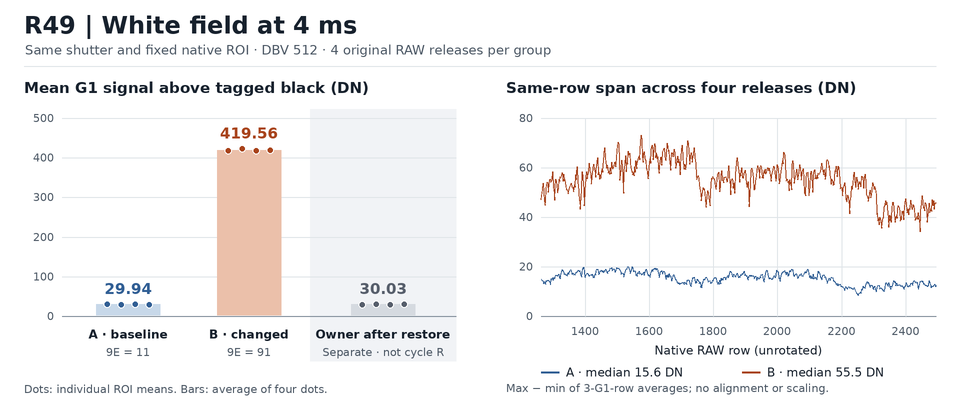

# R49 — изолированная запись `24:9E` при вечернем DBV 512

**Да, адрес `24:9E` влияет на свет.** На неизменном белом поле при одном DBV замена `11 → 91` повысила средний сигнал зелёных сайтов RAW с **29,94 до 419,56 DN (×14,01)** при 4 мс. Обе группы полностью измеримы и не клиппируют. В той же эпохе подтверждены запись, чтение `91` и обратное чтение `11` после явного возврата. Это положительный результат для управления световым выходом, **не** демонстрация аналогового DC: свет в B не совпал с вечерним, а на тех же участках сенсора сигнал заметно менялся даже после интегрирования 4 мс. Частота PWM не установлена.

## Один переход на панели (`confirmed-on-target`)

XT2611-1, GLOBAL `W3WWS36.65-64-4-1`, выбранный BOE ILI97701A v4. Обычная SDR/120 Гц, HWC 0, HBM off, Extra Dim не включён, `panelDC=0`, Flicker prevention OFF, белый HTML `#FFFFFF`. До записи остановлена сессия `0x8e` и проверен сток. Владелец запросил продолжение непосредственно после [предложения одного цикла](../em_analog_check_20261120/result.md#почему-249e-и-что-именно-предложить-владельцу); применён **только** этот цикл, без повтора, перебора соседей или постоянной настройки. Он меняет адрес **`24:9E`** при фиксированном `24:9D=8e`, а не повторяет [R34 с `24:9D=9e`](../direct_camera_r34_20261120/result.md).

| Проверенная фаза | `24:9E` | `23:A9 / 24:9D / 23:80` | `23:C1` | Панельный `00:52` |
|---|---|---|---|---|
| Исходный сток | `11` | `0e / 0e / 50` | `00 02 be` | `02 00` |
| A: однократный вход в известный рецепт | `11` | `8e / 8e / 90` | `00 00 10` | `02 00` |
| B: изменён только младший адрес | **`91`** | `8e / 8e / 90` | `00 00 10` | `02 00` |
| A′: обратная запись, до стока | **`11`** | `8e / 8e / 90` | `00 00 10` | `02 00` |
| Сток после выхода | `11` | `0e / 0e / 50` | `00 02 be` | `02 00` |

Все пять состояний получены в одной wake-эпохе без повторного apply, изменения яркости или растра между A/B/A′. Значения — readback, не интерпретация названий режима. `last_cmd_tx_sts:0x1` проверялся отдельно от принятого bytecount; page 0 — нативный успех возвратного селектора с отдельным чтением DBV, не доказательство покомандного физического ACK. После транзакций проверен `reg_read`, в том числе независимым монтированием. Само по себе неизменное `C1` не означает неизменную эмиссию. [Прямые квитанции](native.txt) · [генератор одноразового исполнителя](build_probe.py) · [локальный контроллер срока и возврата](lease.sh).

## Оптика: что произошло с белым (`confirmed-other-device`)

Nothing A001, основной объектив 1× 5,56 мм, ISO 6400. Тег Orientation `6`, нативные оси Bayer не поворачивались. Предварительно выбранная ROI `[630:1250,754:799]` в ячейках CFA; четыре независимых оригинала на окно. Величины ниже — средние по четырём спускам над тегом чёрного, не кд/м². В таблице O — **отдельное измерение** на том же белом и BL 512 после восстановления владельческой сессии и нового wake. Это не оптическое A′ в основной серии.

| Выдержка | A · `11` | B · `91` | O · восстановленная сессия |
|---|---:|---:|---:|
| 25 мс | 188,07 DN; CAL прошла | все 4 CAL насыщены; среднего для сравнения нет | 190,35 DN |
| **4 мс** | **29,94 DN** (28,88–30,66) | **419,56 DN** (417,98–422,67) | **30,03 DN** |
| 6,667 мс | 49,78 DN | частичный клиппинг; диапазон A/B не сравниваем | не снималось |
| 1,25 мс | 9,83 DN; ниже порога 20 DN | окно не началось | не снималось |



Отдельный **сток** перед опытом дал 29,31 DN на белом/4 мс и 187,23 DN на белом/25 мс (свой чёрный 0,20 DN); стоковый чёрный не подставлялся в A/B. На общей пригодной выдержке цель совпадения ±5% явно нарушена. В O сигнал 4 мс вернулся в исходный диапазон (на **0,31%** выше среднего A). Это независимая функциональная проверка после восстановления, не доказательство того, что свет вернулся в тот же момент, когда регистр прочитался как `11`.

**Осталась ли видимая модуляция в B?** Сравнили четыре спуска B на 4 мс **на одних и тех же строках**: после усреднения трёх соседних G1-строк вычислено `100 × (max−min)/max` по четырём наблюдениям каждой позиции. Медиана по 618 позициям — **12,26%**, P95 — **13,97%**, на всех 618 размах больше 5%. Медианный абсолютный размах **55,52 DN**, P95 **65,58 DN**; в участке вне экрана P95 составил 1,16 DN. Чётные/нечётные столбцы дают P95 14,13/14,50%, корреляция знаковых изменений во всех парах ≥0,966. Границы экрана в проверенных сечениях B стабильны; на самих четырёх коротких кадрах B нет клиппинга, нулевых отсчётов и непокрытых строк защитной области. Этот контроль не заменяет независимую CAL/25 мс. Позиции не являются 618 независимыми опытами. [Расчёт и контроли](repeats.csv).

У A тот же межкадровый показатель составил 41,12% (медиана), но в гораздо более тёмной точке; на самих кадрах A/4 мс защитная область не полностью освещена, отдельная CAL A/25 мс прошла. Нельзя интерпретировать уменьшение относительного размаха как улучшение при одинаковой яркости. В B наблюдается не одна лишь неподвижная неравномерность белого поля; **ни мгновенную глубину OLED, ни длительность провала, ни частоту несущей** по этим кадрам не определили. Данные также не различают изменение аналогового тока и переключение внутренней таблицы DDIC.

## Где закончился проход и что восстановлено

**52 разных прямых RAW, 13 закрытых окон:** 12 стоковых, 28 в основном входе (16 A, 12 B), 12 после восстановления. Геометрия, выдержка, оригиналы, PRE/POST, цвет и состояние проверены по архивам: [сток](stock_windows.csv) / [основная серия](windows.csv) / [владельческая сессия](owner_windows.csv); [RAW-метрики](frames.csv), [сток](stock_frames.csv), [O](owner_frames.csv), [допуск поля](field.csv), [решение по полному A/B/A′](compare.csv).

Перед записью на Lenovo сработал локальный пробный дедлайн: через 5 с перечитано A без записи `9E`. Реальный срок B зафиксирован **до** вызова `candidate` и не продлевался. Для открытия каждого окна требовался запас 28 с; после трёх окон B четвёртое не открылось, а на момент запроса возврата оставалось 19 с. Контроллер не ждал переноса RAW: вернул `11`, подтвердил A′ и сразу восстановил сток. Таким образом, **электронный цикл A/B/A′ закрыт, оптический — нет**: кадров A′ в основной эпохе нет. Недостающие данные не заменены отдельным O или клиппированной CAL. Значение `91` больше не отправляли.

В финале проверены: прежний профиль в новой эпохе `active: verified`, Settings, manual 102 / BL 6692, min/peak `120.0/0`, provider и `panelDC=0`, ESD `reg_read`, thermal 0 без override. Одноразовые файлы и журналы на Lenovo удалены после проверки принадлежности; boot hook не создавался. A001: S/ISO Auto, `PHOTO 2×`. Без flash и пробы глазами.

**Следующий опыт (R50, предложение, не выполнялся).** Проверить, даёт ли обнаруженный яркий режим выигрыш **при вечернем среднем**, а не на 14-кратно более ярком белом. Для отдельного одного разрешённого цикла: A и A′ в первую очередь снять при 4 мс на белом, в B коротко снять белый при 312,5 мкс и сравнить цифровой серый с A только если измеренный свет совпал до ±5% с собственным контролем чёрного. Зарезервировать время на обязательную оптику A′; без совпадения света — не делать равнояркий вывод. Разрешение R49 израсходовано, новый цикл не запускается автоматически.

### Воспроизведение без ADB

```sh
d=artifacts/direct_camera_r49_20261121; m=artifacts/direct_camera_r48_20261121/measure.py
b=../../private-bench-evidence/direct-r49-20261121
python3 -B "$d/build_probe.py" --check
python3 -B "$m" "$b/frames" --orientation 6 | diff -u "$d/frames.csv" -
python3 -B "$d/bind.py" --allow-incomplete "$b" "$d/frames.csv" | diff -u "$d/windows.csv" -
# field.py возвращает 1 из-за насыщения B и отсутствующей CAL R.
python3 -B "$d/field.py" "$b/frames" --orientation 6 --releases 4 | diff -u "$d/field.csv" -
python3 -B "$d/compare.py" "$d/frames.csv" --field "$d/field.csv" | diff -u "$d/compare.csv" -
python3 -B "$d/repeats.py" "$b/frames" | diff -u "$d/repeats.csv" -
for g in stock owner; do python3 -B "$m" "$b/$g/frames" --orientation 6 | diff -u "$d/${g}_frames.csv" -; done
python3 -B "$d/bind.py" "$b/stock" "$d/stock_frames.csv" | diff -u "$d/stock_windows.csv" -
python3 -B "$d/bind.py" --owner-context "$b/owner" "$d/owner_frames.csv" | diff -u "$d/owner_windows.csv" -
```
