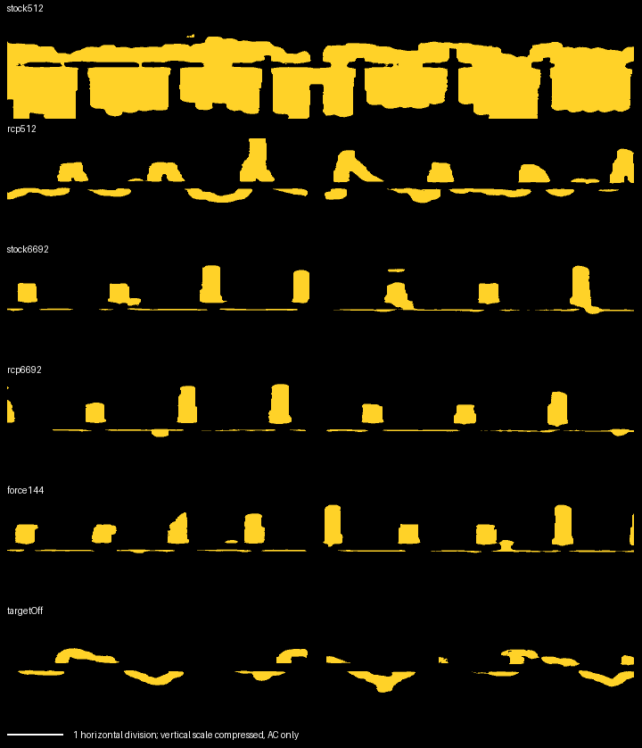

# R32 — что меняется на осциллографе при переключении рецепта, refresh и Extra Dim

**При BL 6692 повторяющийся пик присутствует и в стоке, и с `0x8e`. На рецепте он следует за фактическим refresh: интервал 1,66–1,68 деления при 120 Гц → 1,39 при 144 → 1,66–1,68 при возврате.** Это наблюдение на растре прибора, не доказательство равной глубины, отсутствия иной несущей или причины дискомфорта. При BL 512 формы стока и рецепта отчётливо различаются. До испытаний на глазах оснований нет.



`confirmed-on-target` — состояния Lenovo и реакция стенда в этих переключениях; `confirmed-other-device` — вид прибора через Nothing A001. Идентификация ADB: протокол 41, клиент 34.0.5-debian, XT2611-1 `W3WWS36.65-64-4-1`, UID0; отдельный A001. Камеру не переставляли. Осциллограф в RUN, **AC**, камера в PHOTO 2×. Оригиналы — приватно. В [таблице](raster.csv) все 75 кадров / 25 окон, в рисунке — кадр №2 каждого указанного окна. Маска показывает, где камера различила жёлтую трассу, с пропусками на белых надписях; это не оцифровка напряжения.

## С чем сравнивали

Сцены HTMLViewer; центральная половина по каждой оси screenshot Lenovo проверена на точный RGB. BL ниже — **прочитанный sysfs до/после окна**, не новый readback DCS `00:52`. В каждом включённом окне сохранены `activeMode.hwcId` SurfaceFlinger до/после. Applier работал в своём проверенном wake до `stop`; штатный anti-flicker выключен. `stop` подтвердил **stock registers verified**, только затем снимали stock. Порядок и тройки кадров см. в CSV. Три скриншота видоискателя — не три независимых запуска профиля; частоты кадров A001 в расчёте нет.

| Проверка | Фактический контраст | Что он различает |
|---|---|---|
| Источник сигнала | На белом с рецептом BL 6692/обычные 120: верхний пик `103–104 px`; после выключения Lenovo — нет такого пика в 3/3; после пробуждения и проверенного reapply — `103–104 px`. В обоих концах OFF-окна: Android `mScreenState=OFF`, DRM `DSI-1/dpms=Off`, `bl_power=4`; остаточная волна на приборе **не исчезла**. | У признака есть связь с состоянием дисплея. OFF меняет и свет, и электронику; не заменяет непрозрачную шторку на включённом телефоне. Первая попытка требовала `Asleep` и остановилась без OFF-кадров при `Dozing`; во второй проверены независимо питание коннектора и экран, а не изменено название состояния. |
| Дневная и вечерняя базы | Обычные 120 (`hwcId=0`): в стоке 3601, 6692, 6873 и на рецепте 6692 верхний интервал одинаков в разрешении метода (`103–104 px`). При 512 сток даёт плотный поезд ниже центральной линии; доля жёлтого в нижней полосе `87,44–89,38%`, против `0–0,06%` на рецепте с остаточными пиками. | Рецепт заметно меняет **форму** при 512; он не устраняет дневное повторение. Доля пикселей — не глубина и не duty. Ни ухудшение дневной яркости, ни полное сохранение яркости не установлены. |
| Idle и 144 | С исходными настройками min/peak=`120.0/0`: `hwcId=3`, `mSpecialIdleFlag=1`, время в счётчике `1Hz` на старте 4:52:02.590. При временном `debug.sf.1hz_nit_lower_limit=9999999` getprop изменился, но **загруженный** `1/10Hz NitLowerLimit` остался `0 9999999`, в обеих границах статического окна снова `hwcId=3`. Отдельно: при min=peak=`120→144→120` фактический HWC `0→1→0` и шаг пиков `103–104→86→103–104 px`, сетка оставалась `62 px/дел`. | Горячая запись property **сама по себе не отключила** idle; SurfaceFlinger не перезапускали. Принудительные пары дали требуемые режимы на время окон; не доказана вечная блокировка. Отношение интервалов ≈1,20 соответствует смене 144/120, не повышению основной несущей до 2 кГц. |
| Цифровое затемнение | Stock BL 6873/120, белый, Extra Dim `OFF→ON→OFF`: RGB-диагональ SF `(1,.965,.914)→(.522,.504,.477)→(1,.965,.914)`. В каждом состоянии шаг `103–104 px`. Отдельно рецепт BL 6692/120: белый → #404040 (тот же шаг) → #101010 → #000000 (нет разрешённого пика в верхней ROI) → белый (шаг вернулся). | Штатное преобразование работало при фиксированном BL; оно не убрало повторение на проверенном белом. Оптические средние не уравнены. Результат на тёмном неотличим этим критерием от отсутствия достаточного сигнала; это **не** повтор R28 при BL 512/9D=92 или 9e, не приговор LUT и не подтверждение DC. [Проверка библиотеки и калибровки на OTA](../dpu_dimming_check_20261120/result.md). |

## Как проверить числа и чего ещё не хватает

[Скрипт](raster.py) применяет существующий `scope_native_lags.peaks` (локальные максимумы корреляции, 5…124 px, rho >0,25). На неизменном виде сетки: `x=147:850`, медиана `(R+G)/2−B` на `y=852:884` и `955:995`; независимый синий профиль сетки `1010:1115`. Геометрия/ROI выбраны по текущим кадрам, это описательный анализ, не слепая классификация. В каждом из 75 кадров шаг сетки 62 px. Пустой список — не нулевая частота. Повтор на хосте с приватными кадрами:

```sh
d=artifacts/scope_baselines_r32_20261120
python3 -B "$d/raster.py" ../../private-bench-evidence/scope-r32-20261120 | diff -u "$d/raster.csv" -
```

Если шкала действительно **5 мс/дел**, 103–104 px соответствуют ~119–120 Гц, 86 px — ~144 Гц. Подпись развёртки на полученных фото размыта/пересвечена; не калибровали её по самому refresh. Числа условные. Автопоказание `0.000 kHz` не использовано. Нет второй развёртки, определённой полосы и полярности тракта, а на AC отсутствует постоянная составляющая: **ширина провала до заданного оптического уровня, глубина в процентах, отсутствие низкой огибающей и достижение ≥2 кГц не измерены**. Нет сеанса USB/SCPI в использованном ADB-канале.

Следующий физический checkpoint: не перемещая A001, установить **DC coupling**, оставить в кадре читаемые V/div и time/div, снять при том же gain «датчик закрыт / освещён / закрыт», затем короткую и длинную развёртки. Сначала отличить оптический отклик от наводки/перегруза. После этого — некомпенсированный профиль и 9D=92/9e против равной вечерней яркости. Без этой калибровки повтор AC-серии не решает задачу глубины.

**Возврат проверен:** Lenovo в исходной `Settings.SubSettings`, Android ручная 102, BL 6692, min/peak `120.0/0`, `1hz_nit_lower_limit=0`, ключ Extra Dim снова отсутствует, stock Flicker prevention=0, сессия `running / active: verified` после wake. A001 снова в штатной PHOTO 2×. Новых экспериментальных DSI-записей, изменения загрузки, перезапуска композитора или оценки глазами не было.
