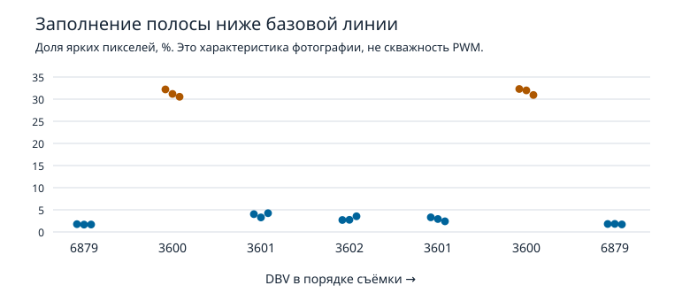

# 3600 / 3601: обратимая граница видимой формы, 2026-11-18

[Метод, единицы D/L и ограничения](../scope_divergence_20261118/result.md). Статус **confirmed-other-device:** по всем 21 фото осциллографа при переходе 3600 ↔ 3601 резко различаются плотность и расположение штрихов на фотографиях экрана прибора в режиме AC. Это описательная граница формы, а не доказательство физической частоты PWM панели. **confirmed-on-target:** согласно receipt считываемый атрибут brightness следовал 6879, 3600, 3601, 3602, 3601, 3600, 6879. Прочитанное actual_brightness осталось 0, поэтому не выдавать этот атрибут или sysfs setpoint за оптический уровень. Исходное приложение и режим SurfaceFlinger 120 Гц; panelDC=0 и provider 0 в проверенных точках. Один последовательный прогон с обратным ходом, не 21 независимый опыт.

| Переход | D медиана (диапазон 9 пар) | L медиана |
|---|---|---:|
| 6879 → 3600 | .429 (.403… .463) | .126 |
| 3600 → 3601 | **.390 (.374… .416)** | .122 |
| 3601 → 3602 | .014 (.008… .019) | .021 |
| 3602 → 3601 | .014 (.007… .019) | .022 |
| 3601 → 3600 | **.407 (.384… .414)** | .132 |
| 3600 → 6879 | .439 (.415… .447) | .125 |
| 3600 прямой → 3600 обратный | .024 (.010… .029) | .024 |
| 3601 прямой → 3601 обратный | .019 (.006… .029) | .026 |
| 6879 исходный → 6879 восстановленный | .019 (.004… .034) | .022 |

Внутри каждой из семи троек D ≤.035. У шести кадров 3600 в нижней полосе 30.5–32.3% ярких пикселей против 2.4–4.2% у девяти кадров 3601/3602; это растровое заполнение, не duty. По шести вариациям порога/положения маски минимум попарного D для 3600 vs 3601/3602 ≥.336; максимум внутри каждого семейства включая 6879 с верхней ветвью ≤.081. На всех 21 кадрах наилучшая целочисленная регистрация по нейтральной области сетки (поиск ±3 пикселя на обеих осях) нулевая, корреляция ≥.985. Это не контроль выдержки внутри кадра или субпиксельных смещений.

**Разведочный анализ лагов**, отдельно от D: в шести кадрах 3600 локальные максимумы корреляции верхней полосы повторяются при 9, 19, 28, 38, 47, 56–57, 66 px; при 3601/3602 наиболее выражен 56–57 px (ещё максимум около 28–30). Мелкая гребёнка ~9.45 px или условно ~1.39 мс / ~720 Гц на **изображении осциллографа** по 34 px/дел и 5 мс/дел. Пик на 56–57 сам по себе легко перепутать с шестым повтором мелкой гребёнки. Числа зависят от геометрии, спектр и фундаментальная частота оптического PWM не установлены. Могут изменяться и оптическая модуляция, и электрическая наводка/питание; не исключены влияние камеры и триггера, наложение развёрток, алиасинг, насыщение прибора, persistence и ограничения полосы. Общая яркость не восстановима из AC. Для атрибуции и разрешения узких повторов нужны другие контрольные условия, не экстраполяция этого числа.

[Кадры](frames.csv), [все парные сравнения и чувствительность](pairs.csv), [проверка сетки и пики](raster_qc.csv). Повторить из корня с Python из requirements: `python 06-tools/scope_pwm/scope_receipt_divergence.py /path/to/boundary-receipt.json NEW_DIR` и `python 06-tools/scope_pwm/scope_raster_qc.py /path/to/boundary-receipt.json NEW_DIR/raster_qc.csv`. PNG хранятся рядом с приватным receipt; в репозитории только производные показатели.
